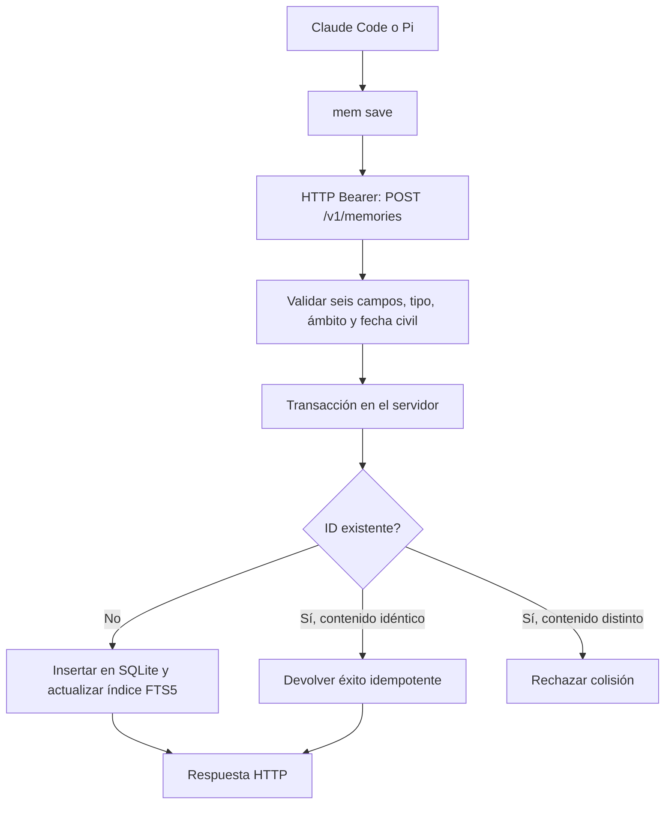
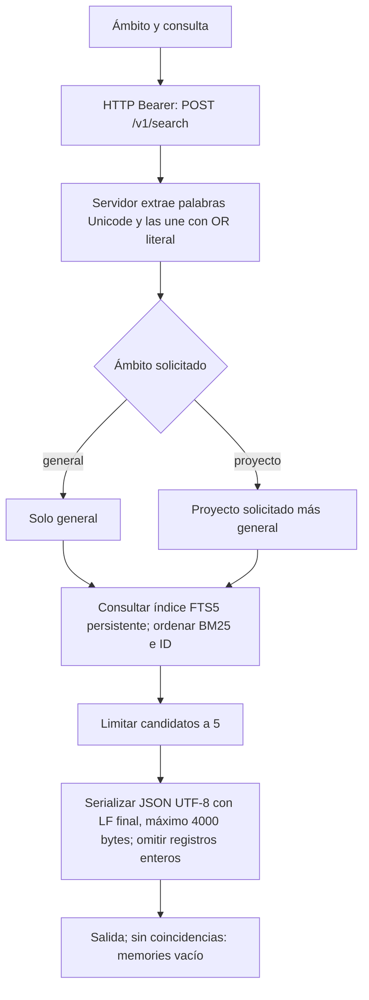

# Flucastr.Memory-AI

Flucastr.Memory-AI guarda recuerdos breves de trabajo en SQLite/FTS5. El servidor central es la única fuente de datos; Claude Code y Pi pueden consultar memorias al iniciar una sesión mediante integraciones instalables.

## Estado del MVP

| Capacidad | Estado real |
|---|---|
| Servidor HTTP central, `mem` remoto y SQLite/FTS5 | Implementado y cubierto por `./verify` |
| Memoria al iniciar Claude Code y Pi | Adaptadores y paquete comprobados localmente; instalación manual |
| Servicio systemd, cron y backup en WSL | Plantillas y backup probados; instalación en el host pendiente |
| Recorrido real Claude Mac → Pi WSL | Validación de Franco, fuera de la aceptación local |

## Componentes y flujos

```text
Claude Code / Pi → cliente remoto `mem` → HTTP Bearer → servidor central → SQLite/FTS5
```

### Escritura



Cada memoria expone `id`, `type`, `scope`, `text`, `origin` y `date`; los tipos son `decision`, `learning`, `resolved-blocker` y `rule`. Los ámbitos son `general` o `project:<nombre>`. `mem` ofrece save, search, recent y forget. Las escrituras actualizan SQLite y FTS5 en una transacción; un ID idéntico es idempotente y el mismo ID con otro contenido se rechaza.

### Búsqueda



La consulta es léxica, no semántica: coincide cualquiera de los términos. No hay embeddings, sqlite-vec ni RRF. El ámbito general no incluye proyectos; el de proyecto incluye también memorias generales. Search devuelve hasta cinco registros completos y no supera 4000 bytes. Recent devuelve 15 por defecto; `--limit N` permite elegir otro límite, sin el tope de bytes de search.

## Integración de agentes

Claude Code tiene un hook SessionStart; Pi carga una extensión ESM desde una ruta explícita. Al iniciar, ambas consultan `mem recent --limit 15`, no escriben y continúan sin bloquear si la consulta falla. Durante el trabajo, sus instrucciones permiten consultar con `mem search` cuando ayude y guardar automáticamente decisiones, aprendizajes y bloqueos resueltos consolidados del proyecto. Las reglas y el scope general requieren petición o confirmación explícita de Franco; el agente solo afirma un guardado si `mem save` devuelve éxito e ID. Requieren Node.js `>=24.22.1 <25`, Git para scope automático, `mem` en PATH y `MEM_URL`/`MEM_TOKEN` en el entorno del agente. Las instrucciones de instalación y uso están en [docs/inicio-agentes.md](docs/inicio-agentes.md).

El scope predeterminado es `project:<nombre de la raíz Git>`. Clones con nombres distintos reciben scopes distintos; repositorios distintos con el mismo nombre raíz comparten scope. Usa un scope explícito si necesitas separar o compartir esos casos. El trabajo no se guarda como transcripción: solo se guardan hechos consolidados y útiles, nunca propuestas pendientes ni secretos.

## Verificación y límites

`./verify` instala desde lock en Docker, compila, ejecuta la suite, prueba CLI/doctor y recorre el servidor con SQLite aislado. La versión rápida con caché es `VERIFY_RAPIDO=1 ./verify`. S4 está integrado mediante PR #13 y S5 mediante PR #14; este cambio añade la política de memoria contextual. Las pruebas locales usan proveedor simulado: comprueban instrucciones y herramientas conectadas a HTTP/SQLite reales, pero no validan el juicio de un modelo comercial ni la instalación Mac→WSL, que Franco probará. La API usa autenticación Bearer y el cliente remoto no crea una base local.
