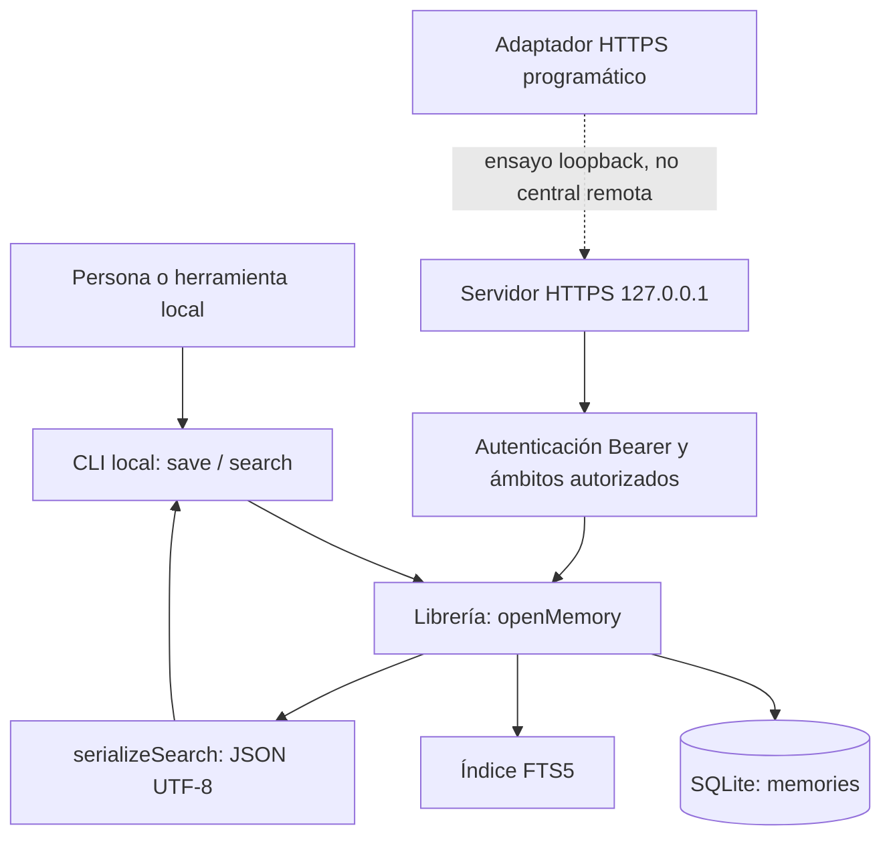
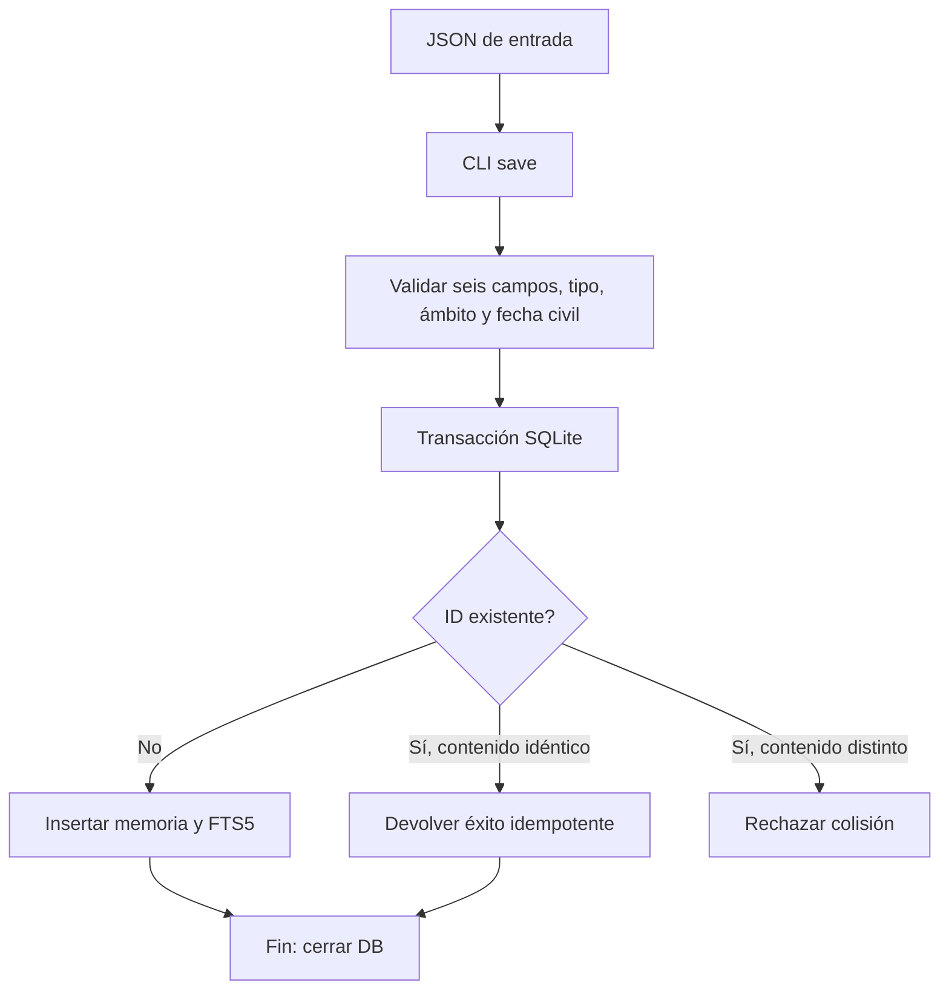
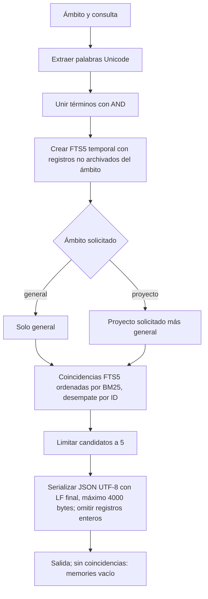

# Flucastr.Memory-AI

Flucastr.Memory-AI es un núcleo local experimental para guardar y recuperar recuerdos breves de trabajo en SQLite/FTS5. Está dirigido a equipos y herramientas que necesitan consultar decisiones, aprendizajes, bloqueos resueltos y reglas por ámbito de proyecto. No es una memoria de agente conectada, un servicio central remoto ni una integración operativa con Mac o Raspberry Pi.

## Estado del MVP

| Capacidad | Estado real |
|---|---|
| Persistencia SQLite y búsqueda léxica FTS5 desde la librería y CLI locales | Implementado en código; ejecución actual no verificada en esta entrega |
| Alta idempotente por ID y rechazo de colisiones con contenido distinto | Implementado en código |
| Contrato HTTPS para ensayos sintéticos en loopback | Adaptadores existentes; pruebas de loopback no acreditan red remota |
| Dataset F02 (30 recuerdos / 10 consultas) | Verificación sintética congelada compara resultados/bytes, no ahorro real de tokens |
| Operación distribuida, Mac/Pi, integración con agentes, identidad humana, custodia de claves y backups independientes | Pendiente; no afirmar desplegado ni operativo |

## Componentes y flujos



### Escritura



Cada memoria requiere `id`, `type`, `scope`, `text`, `origin` y `date`; tipos válidos: `decision`, `learning`, `resolved-blocker`, `rule`. Los ámbitos son `general` o `project:<nombre>`. Una regla general requiere confirmación explícita en la API/CLI. Las escrituras actualizan SQLite y FTS5 en una transacción. `replacesId` relaciona una sustitución, pero no archiva automáticamente la anterior; los conflictos se marcan/resuelven explícitamente y no se deducen por fecha.

### Búsqueda



La consulta es léxica, no semántica: todos los términos deben coincidir. No hay embeddings, sqlite-vec ni RRF. El ámbito general no incluye proyectos. La serialización omite registros completos que excederían 4000 bytes.

## Uso local sintético

Requisitos declarados por el proyecto: Node.js `>=22.23.2 <23` y dependencias de desarrollo instaladas; `npm run build` compila a `dist/` (configurado en `tsconfig.json`). Los comandos siguientes son ejemplos documentales, no ejecutados durante esta revisión. La CLI abre y cierra la base en cada invocación; cada comando siguiente vuelve a abrirla.

```sh
npm install
npm run build
TMP_DIR="$(mktemp -d)"
cat > "$TMP_DIR/memory.json" <<'JSON'
{"id":"demo-1","type":"decision","scope":"project:Atlas","text":"synthetic memory","origin":"quickstart synthetic","date":"2025-01-15"}
JSON
npm run cli -- save --db "$TMP_DIR/memory.sqlite" --input "$TMP_DIR/memory.json"
npm run cli -- save --db "$TMP_DIR/memory.sqlite" --input "$TMP_DIR/memory.json"
npm run cli -- search --db "$TMP_DIR/memory.sqlite" --scope project:Atlas --query synthetic
npm run cli -- search --db "$TMP_DIR/memory.sqlite" --scope project:Atlas --query absent
rm -rf "$TMP_DIR"
```

Por lectura del código, ambas altas idénticas devuelven el mismo ID con `status: saved`; la búsqueda debe incluir `demo-1` y la consulta sin coincidencias devuelve `{"memories":[]}\n`. Estas salidas son esperadas, no observadas en esta entrega. `npm run cli -- --help` muestra ayuda y `npm run cli -- doctor` informa versión SQLite y disponibilidad FTS5; no ejecutados aquí.

## Verificación y límites

Los scripts existentes son `typecheck`, `build`, `test`, `gate:f02`, `gate:f03` y `verify`; no se ejecutaron aquí. No se instalaron dependencias, compiló, inició el producto ni ejecutaron pruebas de runtime/renderizado. No se comprobó la disponibilidad externa de enlaces. El gate F02 usa corpus y consultas sintéticas fijas y compara bytes/IDs: no demuestra ahorro de tokens, calidad semántica ni utilidad con datos reales. El código local tampoco acredita seguridad operacional, aislamiento administrativo, rendimiento ni recuperación ante pérdida de disco.

## HTTPS local sintético (F03)

Las pruebas TLS requieren OpenSSL disponible en `PATH`; generan una CA y un certificado de loopback firmados, claves exclusivamente temporales y limpian el directorio al finalizar.

El adaptador programático `startLocalServer({ store, auth, tls, port })` escucha exclusivamente en `127.0.0.1` por HTTPS; `port: 0` selecciona puerto efímero. `tls` requiere certificado y clave sintéticos válidos. No hay fallback HTTP, CORS, proxy confiable, ejecución CLI ni endpoints administrativos. El propietario conserva y cierra `store`; `close()` cierra el listener y las conexiones.

Solo admite POST JSON de contrato cerrado en `/v1/search`, `/v1/memories`, `/v1/replacements` y `/v1/conflicts`, con autenticación Bearer anterior a la lectura de datos. La instalación es únicamente para ensayos sintéticos Atlas/Birch: no usar datos reales, exponer la interfaz ni interpretar la key compartida como identidad humana o autorización administrativa.

## F02 reproducible synthetic gate

Run `npm run gate:f02` for the standalone F02 gate, `npm run gate:f03` for the standalone F03 gate, or `npm run verify` for the complete local checks and both gates. Node.js 22.23.2 and npm dependencies are prerequisites. F03 gate compiles and runs the HTTP/authentication, authorization, TLS, durability/crash, backup and recovery suites; any missing suite or failed assertion exits non-zero. All F03 runs use synthetic Atlas/Birch data and loopback/temporary destinations only. A passing test process does not prove power-loss or disk-failure behavior; temporary backups are not physically independent; the four-hour RTO is an objective, not demonstrated; separate human administration does not demonstrate shell isolation. Real/private remote networking, encryption and key custody, an independent backup destination, and operational authorization remain pending. Passing the gate does not authorize real data, clients, exposure, deployment, or agent administration.


The corpus, query set, expected IDs, and scopes are frozen for this benchmark version; replace fixture data only as a separately reviewed benchmark change, not to tune results. A large independent synthetic record tests whole-record omission at the output limit without modifying frozen queries.

| Environment | Gate result |
|---|---|
| Linux | No ejecutado en esta revisión documental |
| macOS | No ejecutado en esta revisión documental |

## Recuperación y saneamiento manual (F03 sintético)

**Ensayo solamente:** usar exclusivamente datos sintéticos efímeros, una base/copias dentro de un directorio temporal y procesos de prueba propios. No usar bases, copias, credenciales ni servicios reales. El script/API de restauración no es administración humana ni acredita separación respecto del shell actual.

### Copia y restauración

1. Una persona autorizada por un procedimiento separado pausa escrituras, detiene el servidor/agentes de prueba y cierra todas las conexiones SQLite. No ejecutar la restauración con escrituras concurrentes.
2. Crear una copia diaria con `createSyntheticBackup` hacia un destino temporal. El resultado sintético no es independiente del disco y no acredita una copia segura real. Revisar `syntheticBackupStatus`; no rotar ni borrar archivos fuera del manifiesto.
3. Revisar el snapshot elegido y restaurar solo a una ruta nueva y vacía mediante `restoreSyntheticBackup({ destination, backupName, target })`. Rechaza entradas no publicadas, corrupción o destino ya existente; no sobrescribe la fuente ni destinos existentes. Reabrir el destino con `openMemory`, comparar conteos/estados y verificar una búsqueda conocida antes de reanudar.
4. Revisión humana de evidencia y autorización separada antes de reanudar escrituras. Retirar el entorno temporal de ensayo al concluir. No publicar logs ni contenidos sensibles.

Calendario objetivo aprobado: copias diarias, retención de 7 diarias y 4 semanales; la retención actual solo gestiona entradas del manifiesto. RPO máximo 24 h ante pérdida de disco y RTO objetivo 4 h son objetivos documentados, no resultados ni garantías del ensayo. Destino real independiente, cifrado, custodia/recuperación de claves y aislamiento confiable permanecen pendientes. El tiempo local medido por la prueba no valida RTO real.

### Saneamiento autorizado (runbook, no purga automática)

1. Detener agentes/servidor y pausar escrituras; asegurar cierre de DB. La autorización humana debe proceder de cuenta/instalación/contexto separado del agente y su shell. El entorno actual no puede demostrar esa separación.
2. Si aplica, rotar/revocar credenciales afectadas: rotación cada 30 días con gracia máxima 24 h; ante compromiso, revocación inmediata sin gracia. No incluir valores de credenciales en comandos, evidencia o logs.
3. Inventariar por identificadores únicamente las superficies potencialmente afectadas: base SQLite, índices FTS, journals/WAL, copias diarias/semanales, exportaciones y logs. No copiar ni imprimir el marcador o ningún valor sensible. Determinar con revisión autorizada qué copias retirar; no presentar copias afectadas como recuperación limpia.
4. Reconstruir en destino nuevo solo datos sintéticos limpios y regenerar FTS; validar integridad, búsqueda/restauración y ausencia del registro sintético afectado sin revelar el marcador. Retirar copias identificadas únicamente tras autorización humana; registrar el resultado sin valores.
5. Revisar y autorizar reanudación por separado. Esto no garantiza borrado físico/forense de medios, journaling, snapshots o copias externas. No hay endpoint HTTP, booleano de autoaprobación ni herramienta automática de purga.

Duración descriptiva de los tests solo cuantifica una ejecución local sintética; no se interpreta como RTO.
