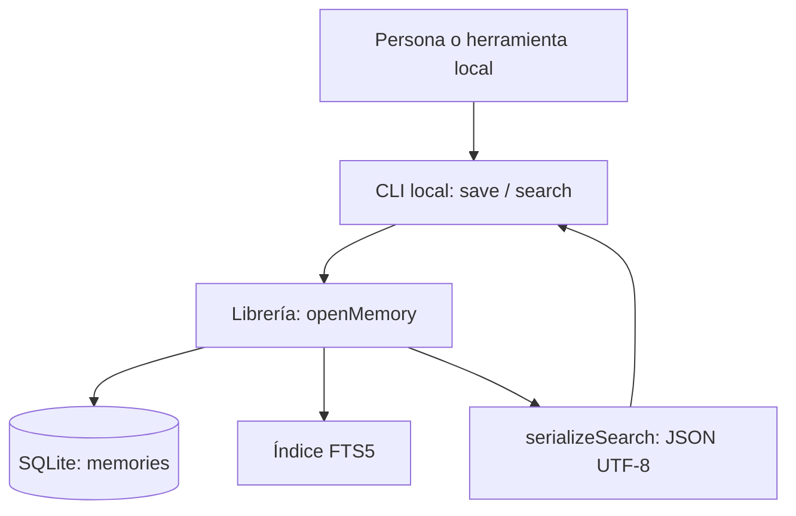
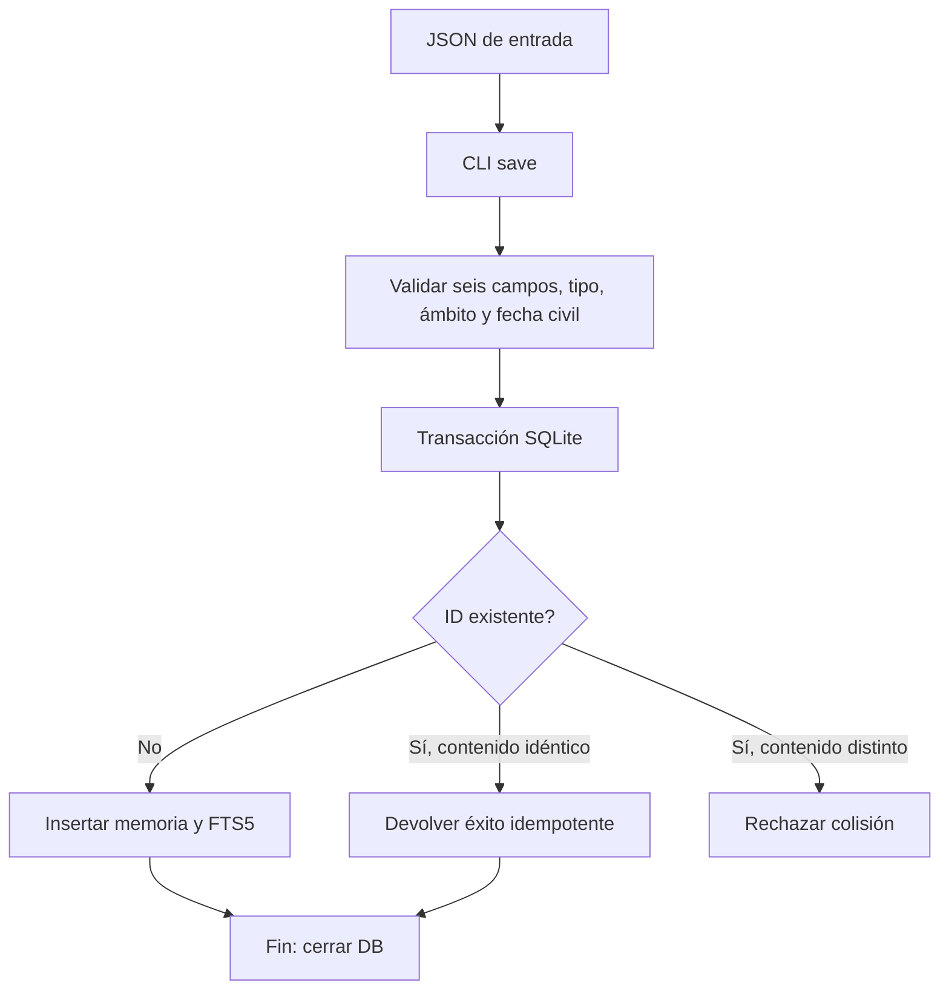
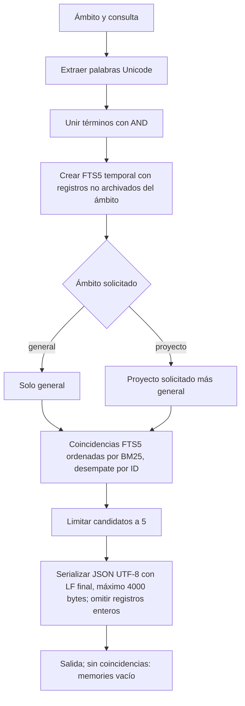

# Flucastr.Memory-AI

Flucastr.Memory-AI es un núcleo local experimental para guardar y recuperar recuerdos breves de trabajo en SQLite/FTS5. Está dirigido a equipos y herramientas que necesitan consultar decisiones, aprendizajes, bloqueos resueltos y reglas por ámbito de proyecto. No es una memoria de agente conectada, un servicio central remoto ni una integración operativa con Mac o Raspberry Pi.

## Estado del MVP

| Capacidad | Estado real |
|---|---|
| Persistencia SQLite y búsqueda léxica FTS5 desde la librería y CLI locales | Implementado en código; ejecución actual no verificada en esta entrega |
| Alta idempotente por ID y rechazo de colisiones con contenido distinto | Implementado en código |
| Operación distribuida, Mac/Pi, integración con agentes, identidad humana, custodia de claves y backups independientes | Pendiente; no afirmar desplegado ni operativo |

## Componentes y flujos



### Escritura



Cada memoria requiere `id`, `type`, `scope`, `text`, `origin` y `date`; tipos válidos: `decision`, `learning`, `resolved-blocker`, `rule`. Los ámbitos son `general` o `project:<nombre>`. Una regla general requiere confirmación explícita en la API/CLI. Las escrituras actualizan SQLite y FTS5 en una transacción. `replacesId` relaciona una sustitución, pero no archiva automáticamente la anterior; los conflictos se marcan/resuelven explícitamente y no se deducen por fecha.

### Búsqueda



La consulta es léxica, no semántica: todos los términos deben coincidir. No hay embeddings, sqlite-vec ni RRF. El ámbito general no incluye proyectos. La serialización omite registros completos que excederían 4000 bytes.

## Uso local sintético

Requisitos declarados por el proyecto: Node.js `>=22.23.2 <23` y dependencias de desarrollo instaladas; `npm run build` compila a `dist/` (configurado en `tsconfig.json`). Los comandos siguientes son ejemplos documentales, no ejecutados durante esta revisión. La CLI abre y cierra la base en cada invocación; cada comando siguiente vuelve a abrirla.

```sh
npm install
npm run build
TMP_DIR="$(mktemp -d)"
cat > "$TMP_DIR/memory.json" <<'JSON'
{"id":"demo-1","type":"decision","scope":"project:Atlas","text":"synthetic memory","origin":"quickstart synthetic","date":"2025-01-15"}
JSON
npm run cli -- save --db "$TMP_DIR/memory.sqlite" --input "$TMP_DIR/memory.json"
npm run cli -- save --db "$TMP_DIR/memory.sqlite" --input "$TMP_DIR/memory.json"
npm run cli -- search --db "$TMP_DIR/memory.sqlite" --scope project:Atlas --query synthetic
npm run cli -- search --db "$TMP_DIR/memory.sqlite" --scope project:Atlas --query absent
rm -rf "$TMP_DIR"
```

Por lectura del código, ambas altas idénticas devuelven el mismo ID con `status: saved`; la búsqueda debe incluir `demo-1` y la consulta sin coincidencias devuelve `{"memories":[]}\n`. Estas salidas son esperadas, no observadas en esta entrega. `npm run cli -- --help` muestra ayuda y `npm run cli -- doctor` informa versión SQLite y disponibilidad FTS5; no ejecutados aquí.

## Verificación y límites

Los comandos de instalación, compilación, CLI y pruebas se ejecutan localmente; su documentación no implica que se hayan ejecutado en esta entrega ni que exista un servicio central operativo. La API de memoria conserva el contrato de solicitudes JSON y autenticación Bearer.
