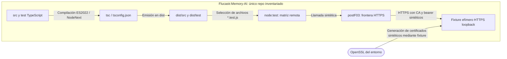

# Andamiaje: revisión de alcance

**BORRADOR independiente.** `disenar-arquitectura`, modo actual: propuestas solo en Observaciones. Encargo de Franco: replantear andamiaje/diagnóstico, no reparar TLS ni sustituir arquitectura, permisos, estados o gates.

## Estructura actual y origen

**Confirmado por lectura:** REPOS §Inventario enumera únicamente `Flucastr.Memory-AI`, sin conexiones entre repos. PROJECT §§Restricciones y Dirección central actualizada conserva TypeScript/Node, núcleo y central SQLite/FTS5 única, cliente delgado y uso explícito. BACKLOG §Organización vigente separa F05 A (habilitante central), B (Claude Code Mac) y posterior R (uso real); F01–F03 conservan su historia. Local no acredita remoto.

Verificación, no despliegue:

**Confirmado:** package.json declara ESM, TS 5.9.3 y gates F02/F03/verify; tsconfig compila src/test juntos, strict/noEmitOnError. El fixture genera certificados de un día con OpenSSL externo, CN localhost y SAN IP:127.0.0.1. http-client usa node:https, CA explícita, timeout 15 s y errores genéricos, sin override de identidad visible (test/f03-tls.ts; src/http-client.ts).

**Configuración:** tsconfig leído; inventario acotado sin `.nvmrc`, `.node-version`, `.npmrc` ni workflows `.github/workflows`; no excluye CI externa. Sin secretos ni configuración global.

## Hechos, inferencias e incertidumbre

1. **Confirmado documental, no reproducido aquí:** task-09 §§Evidencia/Notas registra primer bloqueo de tipado del fixture; después una corrección autorizada y typecheck/build correctos, SAN con `Missing expected rejection`; verify no ejecutado. Los dos fallos cuentan subtest y padre, no dos defectos. Notas conserva el bloqueo antiguo y su reemplazo explícito: no sumar permisos históricos.
2. **Confirmado por encargo:** SAN no rechaza en Node 22.23.2 ni 24.22.1; filtros omitieron SAN/incluyeron hermanos y observador sin datos. Node 24 está fuera de engines. Sin transcripciones inspeccionadas aquí; silencio no acredita éxito.
3. **Inferido de package.json y tsconfig:** engines expresa un rango, no fija el ejecutable efectivo ni OpenSSL. Build no declara limpieza o manifiesto fuente→salida; por eso no acredita por sí solo ausencia de JS residual. **No está confirmado que se haya ejecutado código obsoleto.**
4. **Inferido de la prueba:** compartir servidor y variables dificulta seleccionar un caso y localizar sus efectos. No implica que los hermanos causaran el fallo SAN. Los problemas de filtro y observador reducen la validez del diagnóstico, pero **no son la causa TLS demostrada**.
5. **Hipótesis abiertas, no conclusiones:** interacción entre nombre esperado, material certificado y verificación efectiva; diferencia de artefacto/contexto ejecutado; interacción del fixture o secuencia. Permanecen desconocidos el certificado efectivamente presentado, identidad verificada y recorrido exacto de cada intento reportado. Dos versiones con el mismo síntoma no prueban un bug de Node ni descartan error de fixture/cliente. No corresponde elegir una reparación todavía.

## Observaciones — propuesta, no instrucciones vigentes

### Opciones y coste de mantener/cambiar

| Opción | Beneficio | Coste de cambio y mantenimiento | Límite |
|---|---|---|---|
| A. Continuar ajustes puntuales sobre matriz actual | Menor trabajo inicial; preserva comandos | Cambio bajo; mantenimiento alto por filtros frágiles y evidencia dispersa | No resuelve de raíz trazabilidad ni aislamiento; no recomendada |
| **B. Consolidar el andamiaje existente por capas (recomendada)** | Runtime reproducible, artefacto atribuible, casos aislables y diagnóstico finito sin cambiar stack | Cambio medio acotado a tooling/tests y registro; mantener una matriz, un runner y un esquema de evidencia | No garantiza resolver SAN; requiere autorización antes de construir/ejecutar |
| C. Sustituir runner y entorno por nuevo framework/contenedor | Podría uniformar parte del entorno | Cambio alto, nuevas dependencias, migración y operación; contenedor no demuestra seguridad ni compatibilidad Mac/WSL | Sin necesidad acreditada; nueva superficie y permisos, descartada por ahora |

B preserva stack, repo y entregas. Revisarla solo ante impedimento demostrado de aislamiento/trazabilidad; C requiere aprobación aparte.

### Frente técnico propuesto

- **Runtime reproducible:** baseline exacto Node 22.23.2, dentro del rango vigente; registrar ejecutable/versión efectiva, OS/arquitectura, npm, Node/OpenSSL y OpenSSL externo, flags relevantes y lockfile por digest. Usar instalación reproducible desde lockfile solo con permiso de adquisición/instalación aplicable. Preflight rechaza diferencias antes del ensayo. Node 24 queda solo como antecedente exploratorio, no baseline ni migración implícita. No se promete suministro disponible.
- **Fuente→compilado verificable:** salida limpia y dedicada de pruebas, inventario con digests de fuentes/config/lockfile y salidas emitidas; imports y entrypoints deben resolver al mismo árbol. Excluir salida antigua de selección; discrepancia bloquea. Registro identifica snapshot y delta sin exigir commit ni borrar dist actual como acción automática. Por qué: distinguir fallo observado de artefacto incierto.
- **Casos aislables:** preservar las aserciones y separar casos de seguridad seleccionables por ID estable; cada caso con fixture, servidor, contadores y teardown propios. Selección comprueba IDs esperados contra ejecutados, fallados y omitidos; cero casos o hermanos inesperados invalida diagnóstico. Control positivo HTTPS válido y negativo SAN explícitos. Los gates integrales permanecen, sin reducir cobertura para obtener verde.
- **Observabilidad sanitizada:** modo diagnóstico exclusivamente sintético registra ID de intento, etapa (selección/build/connect/TLS/HTTP/assert), duración, código de error estructurado, nombre esperado sintético, metadatos SAN/tipo y huella del certificado, conexión reutilizada o nueva cuando sea observable. Nunca token, autorización, key, cuerpo, paths privados ni dumps de entorno. Si un dato no es observable se marca ausente, no se inventa. CLI conserva errores genéricos; no habilitar trazas TLS globales ni desactivar validación para observar.
- **Evidencia persistente:** futuro paquete versionable sanitizado con manifiesto de contexto, objetivo/permisos, matriz prevista/real, comandos exactos saneados, códigos de salida, resumen de controles, límites consumidos y conclusión o bloqueo. Salida cruda temporal no se versiona; no guardar PEM/credenciales. Guardar informe aun con fallo, cancelación o selección inválida. Una nueva revisión no convierte retrospectivamente intentos exploratorios en aceptación.

### Frente diagnóstico/aprobaciones propuesto

Aprobar por **objetivo acotado**, no por cada variación menor de comando: ficha única con hipótesis, observaciones necesarias, archivos permitidos, acciones prohibidas, ejecutor, matriz y topes. Dentro de esa ficha, variaciones de invocación solo si conservan IDs, controles y presupuesto; toda ejecución cuenta, también selección inválida. No es permiso vigente ni delegación administrativa al agente.

Separar diagnóstico, reparación y aceptación: fallo detiene dependientes, sin corrección automática. Solo una ficha aprobada puede enumerar casos independientes que continúen ante fallo. Reparar producto TLS exige otro alcance; nunca alterar aserciones para ocultar el rechazo ausente.

Se conservan puertas documentales y operativas, gates F02/F03/verify y límites A/B de F05: cada paquete una ronda, un lote acotado y una reverificación. No se reinician ni recargan rondas consumidas. Si una acción se solapa con ellos, se imputa al presupuesto vigente y exige saldo acreditado; si no lo hay, parar y presentar una única solicitud de alcance adicional, nunca ejecutar por presupuesto nuevo implícito. F04 sigue detenida; no red externa, Mac, Tailscale, host, datos reales, instalación, administración ni gasto por aprobar este borrador.

### Éxito medible propuesto

| Medida | Umbral de cierre |
|---|---|
| Reproducibilidad | 100% de intentos con runtime efectivo y digests; cualquier mismatch bloquea antes de interpretar resultados |
| Fuente/artefacto | 100% de entradas ejecutadas atribuibles al manifiesto; cero salidas ajenas seleccionadas |
| Selección/aislamiento | Caso SAN ejecutable solo por ID, con 1 esperado = 1 ejecutado y cero hermanos; fixture y teardown propios; todo skip inesperado invalida |
| Observabilidad/evidencia | 100% de intentos, incluidos fallidos, con etapa/exit/duración; cero secretos/cuerpos; dato ausente explícito, nunca éxito por silencio |
| Conservación | Matriz anterior mapeada 1:1; controles de CA, SAN y demás denegaciones intactos; aceptación global solo con todos los gates vigentes correctos |
| Diagnóstico TLS | Cierra con explicación sustentada o bloqueo preciso; SAN sin rechazo sigue bloqueando seguridad y F05, aunque el andamiaje mejore |

### Presupuesto, adopción finita y rollback propuestos

**Estimación/tope a aprobar, no compromiso:** hasta 8 horas activas para tooling/tests/documentación en un único lote, un entorno local ya autorizado, cero gasto y cero dependencias nuevas; máximo 3 invocaciones de diagnóstico prefijadas y 1 pasada integral condicionada a controles previos correctos. Cada invocación hasta 5 minutos; máximo 20 minutos de ejecución total; evidencia sanitizada hasta 10 MiB. No autoriza adquirir runtime, preparar entorno ni otorga rondas adicionales A/B. Si no es viable dentro del presupuesto vigente, cerrar bloqueado antes de operar. No se evaluó aquí capacidad para cumplir estos techos.

1. **Puerta documental:** aprobar ficha, matriz, límites y saldo compatible con gates; sin ello, parar.
2. **Lote autorizado:** runtime/manifiesto, aislamiento/selección y reporte; sin producto TLS; mapa de cobertura y revisión del delta antes de ejecutar.
3. **Validación autorizada:** preflight y diagnóstico prefijado dentro de tres invocaciones, sin experimentos emergentes. Integridad/selección inválida detiene; fallo funcional impide integral.
4. **Cierre:** solo con controles previos correctos, una integral con gates existentes. Informe único separa aceptación del andamiaje, SAN pendiente/resuelto y saldo; sin ronda automática.

**Rollback propuesto:** revertir solo el lote nuevo autorizado, conservar evidencia y bloqueo SAN, sin tocar producto/datos. Reversión no localizada exige parada; volver atrás no acredita verde.

**Paradas:** permiso/gate faltante, secretos/datos reales, techo agotado, mismatch de runtime/artefacto, selección inválida, observación indispensable ausente o necesidad de producto/dependencia/red/host/contrato nuevo. Registrar bloqueo, sin repetición automática ni TLS relajado. F04 y adquisición siguen pausados.

### Decisiones para Franco

1. **Alcance:** A) aprobar B técnico + flujo como futura intervención acotada (**recomendado**); B) aprobar solo diseño técnico y conservar flujo actual; C) mantener pausa sin adopción. Aprobar dirección no sustituye la ficha operativa ni permisos faltantes.
2. **Presupuesto:** A) aceptar el techo propuesto sujeto al saldo/gates vigentes (**recomendado**); B) limitar la siguiente entrega a especificación documental, sin construcción/ejecución; C) rechazar intervención por ahora. No se solicita elegir flags, certificados o framework: los detalles técnicos recomendados están arriba.

## Límites

Solo lectura y este borrador; sin pruebas ni operación. No certifica TLS/gates. Franco decide alcance/presupuesto; sin continuación automática.
