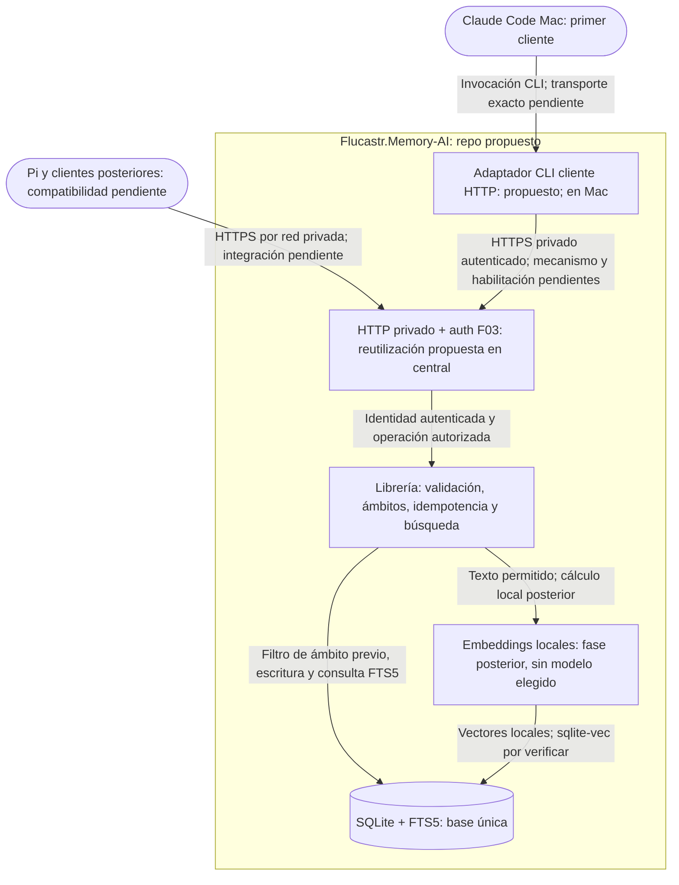

# Arquitectura propuesta — modo nueva

## Estructura y su razón
**Documento aprobado por Franco junto con los documentos de puerta 1; las propuestas no resueltas conservan su carácter de propuesta.** Enmienda explícitamente aprobada antes de F02 incorporada solo en los puntos afectados. Entradas: requisitos explícitos de Franco recogidos en PROJECT.md y su enmienda. Se propone un único repo Flucastr.Memory-AI con librería independiente y adaptadores CLI/HTTP: simplicidad y reutilización. Varios repos no aportan hoy independencia demostrada; reconsiderar si aparecen equipos o ciclos separados. No se presupone estructura de carpetas ni dependencias.

## Diagrama
Vista conceptual objetivo actualizada, no despliegue acreditado. **Confirmado — origen: encargo actual y propuesta exacta ab125df6 citada en PROJECT.md §Dirección central actualizada:** Franco aprobó actualizar definición y preparar presupuesto para Claude Code Mac → CLI → HTTP privado F03 → central única SQLite/FTS5; no aprobó construir ni el presupuesto nuevo. HTTP sigue fuera de slice 1 histórica. Se conserva abajo el ensayo local anterior como antecedente. Host, acceso privado y compatibilidad pendientes; las flechas son objetivo, no conexiones verificadas.

## Componentes
| Componente | Responsabilidad | Tecnología | Origen del dato |
|---|---|---|---|
| Librería | Validar contenido/metadatos, idempotencia, ámbitos previos y límites de salida | TypeScript/Node confirmado; interfaces pendientes | Encargo de Franco |
| CLI | Guardar/buscar para primer cliente Mac | TypeScript/Node confirmado; comandos aún no definidos | Encargo de Franco |
| Base única | Persistencia y búsqueda léxica | SQLite+FTS5 confirmado conceptualmente; binding/build no verificado | Encargo de Franco |
| HTTP privado | Acceso multidispositivo autenticado | Requisito confirmado; framework/auth/transporte por elegir | Encargo de Franco |
| Embeddings | Búsqueda semántica posterior con fallback FTS5 | Local, pequeño; sqlite-vec+RRF indicados como orientación posterior, compatibilidad pendiente | Encargo de Franco |
| Clientes | Consumir núcleo por adaptadores, sin réplicas iniciales | Claude Code CLI primero, Pi después, móviles posteriores; MCP no prometido | Encargo de Franco |

## Decisiones
| Decisión | Por qué | Descartado y por qué | Qué la cambiaría |
|---|---|---|---|
| Propuesta: único repo | Núcleo y adaptadores comparten contrato | Repos por dispositivo: complejidad sin evidencia | Ciclos/equipos independientes |
| Confirmada: filtro antes de búsqueda | Evitar filtración entre proyectos | Filtrar solo resultados: no satisface requisito | No cambia sin aprobación explícita |
| Propuesta: autorización de ámbito dentro del núcleo para ambos adaptadores | No confiar solo en filtro enviado por cliente | HTTP como único guardián: CLI podría divergir | Definición técnica de autorización HTTP |
| Confirmada — enmienda de Franco: proyecto incluye ese proyecto + general; general solo general; nunca cruzar proyectos | Memoria general reutilizable con aislamiento | Cruce de proyectos o exclusión de general en consulta de proyecto: incumplen contrato | Cambio explícito de ámbitos |
| Confirmada — enmienda de Franco: CLI slice 1 usa identidad local confiable y exige confirmación explícita al guardar reglas generales | Acceso local sin adelantar autenticación API | Auth HTTP en slice 1: fuera de alcance; general sin confirmación: no autorizado | Auth API en su slice correspondiente |
| Confirmada — enmienda de Franco: ID estable del emisor, reintento idéntico sin duplicación, mismo ID y contenido distinto rechazado | Idempotencia sin confundir cambios con reintentos | Deduplicación automática por texto o sobrescritura del mismo ID: no cumplen identidad del contenido | Cambio explícito del contrato |
| Confirmada — enmienda de Franco: sustitución con nuevo ID y referencia anterior; conflictos señalados hasta resolución humana de Franco | Preservar antecedentes y no decidir verdad automáticamente | Resolución automática por fecha: no prueba verdad | Nueva política aprobada |
| Confirmada — enmienda de Franco: sin caducidad/purga automática; archivados excluidos de búsqueda normal | Evitar pérdida automática y resultados obsoletos archivados | Caducidad por tipo: riesgo de pérdida no aceptado en este contrato | Nueva política aprobada |
| Confirmada: HTTP privado autenticado antes de embeddings | Multidispositivo tiene prioridad | Exposición pública o inferencia primero: fuera de restricciones | Cambio explícito de alcance |
| Propuesta: alojamiento diferido | Falta equipo, presupuesto y disponibilidad | Elegir VPS o equipo ahora: supuesto injustificado | Revisión de comparación en PROJECT.md |

### Política F03: HTTP local sintético
**Confirmado — origen: aprobación explícita de Franco comunicada en el encargo de esta actualización.** Esta política acota F03, no acredita implementación ni integración de clientes. La incorporación documental queda como borrador para revisión de fidelidad; no reabre lo ya aprobado.

| Decisión | Por qué | Descartado y por qué | Qué la cambiaría |
|---|---|---|---|
| HTTP local únicamente con datos sintéticos y proyectos ficticios Atlas/Birch | El entorno actual no acredita separación frente al agente y su shell | Datos reales o prometer aislamiento del shell: no hay evidencia que lo sostenga | Separación acreditada y autorización explícita de Franco |
| Key compartida representa una única identidad | Refleja la identidad aprobada sin atribuciones ficticias | Identificar cliente o humanidad por esa key: no es demostrable; revocación individual por cliente: no corresponde a una identidad compartida | Nueva política de identidades aprobada |
| Allowlist cerrada Atlas/Birch y autorización fail-closed, incluida toda referencia a registros | Evitar acceso cruzado por ámbito, ID o relaciones | Confiar en el ámbito declarado o validar solo el nuevo registro: permite referencias fuera de permiso | Cambio explícito de permisos |
| Administración humana manual separada, sin tickets, y acciones protegidas cerradas por HTTP | La posesión de la key no prueba intervención humana | Booleanos administrativos o confirmaciones HTTP: no establecen una frontera humana; tickets: no aprobados | Nueva política explícita y separación acreditada |

**Operaciones de agentes autorizadas por HTTP:** buscar; guardar recuerdos ordinarios de los cuatro tipos en `project:Atlas` y `project:Birch`, y de los tres tipos distintos de `rule` en `general`; marcar conflictos; sustituir únicamente dentro del mismo proyecto autorizado. Se mantienen identidad, idempotencia y contratos de F02. Buscar en un proyecto autorizado compone ese proyecto más `general`; buscar en `general` devuelve solo general. Esa composición no concede acceso a ningún otro proyecto. La allowlist restringe la autorización de esta identidad HTTP, no modifica la sintaxis abierta de nombres del contrato F02.

**Comprobación de referencias:** antes de consultar o mutar mediante IDs o relaciones, comprobar permisos sobre los registros referenciados además del ámbito solicitado y del registro nuevo. Incluye registros anteriores de sustitución y participantes de conflicto; una sustitución exige que ambos pertenezcan al mismo proyecto autorizado. Si no puede acreditarse el permiso, rechazar sin mutación ni revelar contenido fuera de permiso. No basta que el cliente declare Atlas/Birch.

### Rotación, durabilidad y recuperación F03
**Confirmado — origen: Franco respondió «si, apruebo todo» a las propuestas explícitas reproducidas en el encargo de esta actualización.** Se aprueban las políticas siguientes, no una implementación ni resultados de pruebas. Esta incorporación documental es **borrador de fidelidad**; no reabre las decisiones aprobadas.

| Decisión | Por qué | Descartado y por qué | Qué la cambiaría |
|---|---|---|---|
| Rotar la key compartida cada 30 días, con gracia máxima de 24 h para actualizar clientes | Acotar vigencia y permitir la transición aprobada | Vigencia indefinida o gracia mayor: fuera de la política aprobada | Nueva aprobación explícita de Franco |
| Ante filtración, revocación inmediata sin gracia; afecta a toda la identidad compartida | Cortar el acceso comprometido sin atribuir identidades individuales ficticias | Mantener la key filtrada durante la gracia: contradice la revocación inmediata | Nueva política de identidades y seguridad aprobada |
| Copias diarias; RPO máximo de 24 h ante pérdida de disco; RTO objetivo de 4 h; retención de 7 diarias y 4 semanales | Fijar los objetivos de recuperación y conservación aprobados | RPO cero ante pérdida de disco, RTO garantizado o retención indefinida: no aprobados ni demostrados | Nuevos objetivos aprobados o evidencia que exija revisar su viabilidad |
| Pruebas locales exclusivamente con claves y datos sintéticos efímeros y destino temporal | Permitir validar el diseño local sin usar información confiable ni inventar infraestructura | Copias reales o considerar el temporal independiente del disco: no hay destino real definido ni independencia acreditada | Destino real independiente, cifrado, custodia y separación administrativa concretados y autorizados |
| Para uso real, copias cifradas en destino independiente y custodia de cifrado detallada antes de habilitarlo | La recuperación de un disco perdido requiere una copia accesible fuera de ese fallo y claves recuperables | Inventar ruta, proveedor o custodio a partir de «apruebo todo»: la aprobación no proporciona esos datos | Definición y aprobación explícitas de esos detalles |

**Administración:** rotación y revocación se administran solo desde un contexto confiable separado; no se agregan endpoints de agentes para gestionar claves. Se conservan sin tickets, la pausa de escrituras y todas las acciones protegidas cerradas por HTTP de §Seguridad. En el entorno local sin separación acreditada solo pueden ensayarse estos comportamientos con material sintético efímero, sin afirmar una frontera segura frente al shell del agente.

**Durabilidad y evidencia:** el objetivo ante caída/reinicio del proceso es no perder escrituras confirmadas, sujeto a pruebas; no equivale a RPO cero ante pérdida de disco. Las pruebas locales deben verificar rotación ordinaria y fin de gracia, revocación inmediata por filtración, restauración y conservación de escrituras confirmadas ante caída del proceso, sin presentar estos resultados como ya obtenidos. Restaurar desde un destino temporal permite probar el procedimiento, pero no acredita independencia física, protección ante pérdida de disco ni un RTO real medido de 4 h. El objetivo RPO de 24 h corresponde al escenario de copias reales independientes; no es una garantía del entorno sintético.

**Alcance para planificación — inferido de la política aprobada:** la definición permite descomponer F03 **LOCAL sintética**, manteniendo allowlist Atlas/Birch, identidad compartida y permisos previos, sin elegir hosting, integrar clientes reales ni habilitar uso remoto/real. Los mecanismos técnicos de autenticación, revocación, copia consistente y restauración deben concretarse y probarse durante ese diseño local; esta conclusión no modifica BACKLOG.md ni STATUS.md ni declara la entrega implementada.

### Contrato mínimo de entrada F02
**Confirmado — origen: aprobación explícita de Franco del contrato mínimo F02 comunicada en el encargo de esta incorporación.**

- El recuerdo es un objeto cerrado con exactamente seis campos obligatorios de tipo string, nunca null: `id`, `type`, `scope`, `text`, `origin`, `date`. Se rechazan campos extra y entradas inválidas antes de escribir; no se imponen límites arbitrarios de longitud.
- `id`, `text` y `origin` deben contener algún carácter no blanco. Sus valores se conservan literalmente, sin recorte ni normalización.
- `type` admite únicamente `decision`, `learning`, `resolved-blocker` o `rule`.
- `scope` es exactamente `general` o `project:<nombre>`; el nombre debe ser no vacío, sin blancos extremos y sensible a mayúsculas. No se enumera ni restringe el conjunto de proyectos.
- `date` es la fecha civil del hecho atribuida y aportada obligatoriamente por el emisor, no la fecha de guardado, y no tiene valor por defecto. Su formato exacto es `YYYY-MM-DD`, con años `0001`–`9999` y fecha válida del calendario gregoriano, sin horas, zonas ni conversiones. No se incorporan timestamps internos.
- El mismo `id` y los mismos seis valores literales identifican el mismo recuerdo: el reintento no inserta; el orden de propiedades es irrelevante. Cualquier diferencia con el mismo `id` se rechaza sin mutación. IDs distintos con igual texto se conservan.
- La confirmación de una `rule` de ámbito `general` es la opción de operación `confirmGeneralRule`, no un campo del recuerdo. Los contratos existentes de ciclo de vida se mantienen sin ampliación.

**Decisión y justificación:** fijar este contrato mínimo permite validar la entrada e identidad sin inventar un esquema durante la construcción. Se descartan campos adicionales, normalización, fechas de guardado/defaults y deduplicación por texto porque alterarían el contrato aprobado. Cambiarlo requiere nueva aprobación explícita de Franco; no decide el esquema físico ni el algoritmo técnico.

## Seguridad
**Confirmado — origen: aprobación explícita de Franco en el encargo F03.** Crear reglas generales, sustituir recuerdos generales, archivar en cualquier ámbito, resolver conflictos y administrar claves, restauraciones o saneamiento están **cerrados por HTTP**. No se habilitan mediante `confirmGeneralRule`, otros booleanos administrativos, una key compartida ni una declaración de humanidad. La confirmación local de F02 no es autorización administrativa HTTP.

La administración humana es manual y separada, sin tickets; requiere cuenta, instalación y datos fuera del alcance del agente y de su shell, con pausa de escrituras durante revisión y ejecución. El entorno actual **no acredita esa separación**: F03 queda limitado a datos sintéticos y no habilita administración protegida sobre datos confiables. No se promete aislamiento del shell ni se presenta la CLI actual como canal humano seguro. Señalar conflictos no equivale a resolverlos.

## Supuestos y pendientes
- El esquema mínimo de entrada F02 queda aprobado en §Decisiones, «Contrato mínimo de entrada F02». Siguen pendientes dependencias, versiones, algoritmo técnico exacto de idempotencia y esquema físico de persistencia. El contrato funcional de ID estable del emisor, reintentos, rechazo y sustitución queda aprobado arriba; no hay deduplicación automática por texto.
- **Confirmado — origen: encargo F03:** composición F02 e identidad local de CLI conservadas; para HTTP local sintético quedan aprobadas identidad única con key compartida, allowlist Atlas/Birch y operaciones acotadas en §Decisiones y §Seguridad. La key no atribuye cliente ni humanidad y su revocación afecta a la identidad compartida; no se afirma que el mecanismo esté implementado. La VPN no autoriza por sí sola operaciones o proyectos.
- **Confirmado — origen: aprobación «si, apruebo todo» comunicada en el encargo:** rotación cada 30 días, gracia máxima de 24 h y revocación inmediata sin gracia ante filtración; copias diarias, RPO máximo 24 h ante pérdida de disco, RTO objetivo 4 h y retención 7 diarias + 4 semanales, según §Decisiones, «Rotación, durabilidad y recuperación F03». Los mecanismos concretos quedan por diseñar y verificar localmente, no las políticas ya aprobadas.
- **Pendiente para uso real/remoto — origen: datos no proporcionados en el encargo:** nombre/ruta y características del destino real independiente; mecanismo de cifrado y custodia/recuperación de sus claves. La aprobación no identifica infraestructura ni custodio. Deben detallarse antes de usar copias reales; no bloquean la descomposición LOCAL sintética con destino temporal. Backup/restauración y saneamiento siguen cerrados administrativamente por HTTP.
- **Pendiente — origen: encargo F03:** acreditar cuenta, instalación y datos administrativos fuera del alcance del agente/shell y el procedimiento de pausa de escrituras antes de usar datos confiables. HTTPS remoto privado queda pendiente de mecanismo y despliegue, sin elegir infraestructura ni prometer clientes integrados. Esta actualización no altera backlog, dependencias ni estados.
- No registrar secretos ni cuerpos completos por defecto: propuesta para revisión, no decisión nueva.
- **Confirmado — origen: aclaración explícita de Franco en este encargo:** servidor prioritario para memoria y embeddings; Mac cliente actual y posible anfitrión futuro, sin compatibilidad Mac exigida en F04 ni sincronización entre memorias. Se descarta condicionar F04 a los 8 GB o al trabajo concurrente del Mac porque no es el anfitrión prioritario; cambiarlo requiere decisión explícita. Servidor aún no elegido: viabilidad y recursos pendientes antes de pruebas; modelo/licencia, soporte runtime/OS, disponibilidad de sqlite-vec y memoria siguen por verificar para el anfitrión que se elija, sin elegirlos aquí. No se asume GPU compartida entre Mac y WSL. La prioridad no autoriza despliegue ni amplía F03 local sintético; remoto, seguridad y custodia real siguen pendientes. **Actualización confirmada — encargo de Franco, 2026-11-01:** Franco respondió «si, apruebo» a la solicitud conjunta de fidelidad servidor prioritario/Mac futuro, evaluación documental sin descargas/instalaciones/ejecución y comparación sintética DESCRIPTIVA inicial F04. Se autoriza esa evaluación, no elegir definitivamente combinación ni recursos ni descargar. Véase la observación F04 siguiente; no se fijan umbrales.
- **Contrato de gate confirmado — enmienda de Franco:** 30 recuerdos sintéticos verosímiles MVP de decisiones, aprendizajes, bloqueos resueltos y reglas; ámbito general y al menos dos proyectos ficticios; 10 consultas con esperados top 5 prefijados. Corpus versionado, separado de lógica y reemplazable por datos reales. Reemplaza la exigencia inicial de datos reales; baseline = archivo de concatenación del mismo corpus completo. No generar corpus ni código en esta enmienda; aún no existen estos artefactos y no se afirma que el gate pasó.
- **Contrato de salida confirmado — enmienda de Franco:** máximo cinco recuerdos y 4000 bytes de respuesta serializada UTF-8 completa, incluido salto final. Omitir recuerdos enteros que no caben, nunca truncarlos. Comparar con baseline sin umbral porcentual adicional. El informe de reducción de contexto es solo resultado de prueba, no uso real ni ahorro real. Se descartan baseline de datos distintos y conteo parcial porque no permiten validar este contrato; cambiarlo requiere decisión explícita.
- Orden completo posterior no aprobado; solo slice 1 conceptual y restricciones de precedencia confirmadas.

## Observaciones — evaluación documental F04, 2026-11-01

> **BORRADOR / PROPUESTA NO APROBADA.** Esta sección no reemplaza decisiones vigentes, no selecciona servidor/modelo/runtime y no autoriza descargas, instalación, pruebas, implementación ni despliegue. La continuación autoriza planificar documentalmente la validación de los candidatos, no su adopción definitiva. Modo actual: observaciones sobre implementación leída y posible ampliación, separada del diagrama conceptual vigente. Evaluación documental autorizada por el encargo de Franco; combinación y dimensionamiento requieren aprobación posterior.

### Base comprobada y alcance de la evidencia

**Confirmado por lectura local:** `package.json` y `package-lock.json` exigen Node `>=22.23.2 <23`, TypeScript `5.9.3`, `@types/node 22.19.15`; no incluyen runtime de embeddings ni sqlite-vec. `src/memory.ts:77` abre `DatabaseSync(path)` sin habilitar extensiones; usa esquema versión 2, FTS5 `unicode61`, selección previa por ámbito y archivado, consulta léxica AND y orden bm25/ID. `src/index.ts` usa `node:sqlite`; `src/recovery.ts` también depende de este binding. No se comprobó aquí la versión del ejecutable Node ni el build SQLite ejecutando código. `README.md` describe gates y benchmark congelado, y limita F03 a HTTPS loopback sintético. PROJECT/REPOS/BACKLOG contienen fotografías históricas desactualizadas (p. ej. README vacío y ausencia de andamiaje); esta observación no modifica sus estados ni adjudica resultados de pruebas.

**Confirmado — encargo y PROJECT:** servidor prioritario aún no elegido, Mac solo cliente y anfitrión futuro posible. F03 hecha en backlog no acredita remoto privado, HTTPS operacional, custodia/cifrado ni aislamiento administrativo real. Todo ello sigue pendiente. Sin modelos, binarios o dependencias descargados; se consultaron solamente páginas y metadatos públicos.

### Dos alternativas locales pequeñas

Datos documentales de autores [S3–S6], no mediciones propias. MB decimales; tamaño ONNX no equivale a descarga total ni RAM. Los repositorios `main` son mutables y aún no constituyen un manifiesto reproducible aprobado.

| Opción | Licencia y español | Tokenización y representación | Descarga documental y costos | Valoración propuesta |
|---|---|---|---|---|
| **A: multilingual-e5-small**, original `intfloat`, exportación ONNX `Xenova/multilingual-e5-small` | Original MIT; ficha enumera español entre idiomas multilingües. Revisar también licencia/avisos del artefacto convertido antes de aceptar su redistribución | 384 dimensiones; receta original: prefijos literales `query: ` / `passage: ` incluso en español, media con máscara y normalización L2; máximo 512 tokens, no caracteres. Tokenizador y configuración deben pertenecer a la misma revisión del export | Metadatos: `model_quantized.onnx` **118.308.185 bytes**, FP32 **470.268.533 bytes**. Sumar tokenizer/config/licencias/runtime; total no inventariado. Cuantización puede alterar ranking | **Recomendada provisionalmente** por orientación explícita a recuperación y ventana más amplia, no por superioridad medida |
| **B: paraphrase-multilingual-MiniLM-L12-v2**, original sentence-transformers, exportación ONNX Xenova homónima | Original Apache-2.0, español explícito; conservar avisos y comprobar conversión | 384 dimensiones; mean pooling con máscara; receta original sin prefijos E5 y máximo **128 tokens**. Normalización L2 propuesta para similitud consistente; validar tokenizador/config del export, sin asumir 512 por capacidad del backbone | `model_quantized.onnx` **118.308.126 bytes**, FP32 **470.268.510 bytes**; auxiliares y runtime adicionales sin total verificado | Alternativa si el corpus breve y comparación sintética favorecen su utilidad; descartada como primera recomendación por ventana menor y objetivo de paráfrasis, no por tamaño |

**No verificado:** equivalencia numérica de conversiones, desempeño en español de este corpus, opset/kernels del ONNX cuantizado con runtime propuesto, licencia completa de cada snapshot y descarga completa exacta. Las fichas originales no prueban la conversión. Textos F02 no tienen límite de longitud: no rechazar ni truncar el recuerdo persistido por el límite del encoder. La política para textos largos ya fue aprobada en la continuación documental: véase «Política aprobada de textos largos»; no imponer un límite de entrada. Versionar modelo, revisión, tokenizador, prefijos, pooling, normalización y dimensión; cambiar cualquiera requiere regenerar vectores, nunca mezclar espacios.

### Combinación candidata y compatibilidad documental

**Propuesta NO APROBADA:** Node **22.23.2**, binding existente `node:sqlite`, **sqlite-vec 0.1.6**, **@huggingface/transformers 3.7.2** con **onnxruntime-node 1.21.0**, CPU Linux x64 glibc, opción A ONNX cuantizada, vectores float32 de 384 componentes. Versiones escogidas como conjunto documental candidato, no como garantía de soporte actual, seguridad ni recomendación de versiones más recientes. No cambiar engines/lock en esta evaluación. Antes de autorizar instalación: revisar mantenimiento/vulnerabilidades y fijar revisiones/digests y árbol transitivo. Usar inferencia en el propio servidor, no APIs remotas.

- **Comprobado documentalmente [S1]:** Node 22.23.2 documenta `allowExtension` (por defecto false), `loadExtension` y `enableLoadExtension`; estos últimos incorporados en 22.13.0. **[S2]** sqlite-vec declara soporte de `node:sqlite`, pero su ejemplo menciona Node >=23.5.0. Por el backport documentado de Node, la compatibilidad con 22.23.2 es **inferencia razonada, NO validación ejecutada ni certificación del par exacto**. No obliga por sí sola a migrar a Node 23 (fuera de engines).
- **Comprobado documentalmente [S2/S7]:** sqlite-vec 0.1.6 publica paquetes Linux x64/arm64 y Darwin x64/arm64; npm declara `MIT OR Apache` y el tag ofrece licencia MIT. Disponibilidad de paquete no prueba ABI, libc, permisos ni carga en el servidor elegido. No asumir Alpine/musl. La limitación de SQLite de sistema en el ejemplo macOS/Bun no demuestra una limitación idéntica de `node:sqlite`; Mac queda por verificar en una fase futura.
- **Comprobado documentalmente [S8/S9]:** manifiesto Transformers.js 3.7.2 Apache-2.0 fija `onnxruntime-node 1.21.0`, además incluye sharp y otras dependencias (no sumar solo el modelo). Documentación ONNX Runtime anuncia CPU Node Linux x64/arm64; no prueba el grafo cuantizado concreto con esa versión. Licencias transitivas y requisitos nativos exactos de distro/CPU siguen pendientes. CPU x64 glibc reduce incertidumbre inicial frente a ARM/musl/GPU; no acredita compatibilidad binaria.
- **Propuesta de seguridad:** cargar únicamente librería local fijada y verificada al abrir la conexión, habilitar carga solo durante inicialización y deshabilitarla después. Nunca aceptar rutas/SQL de extensiones del cliente. El constructor actual no permite activarla después sin modificación: requiere diseño posterior, no está implementado. Si el build, permisos o política del host impiden extensiones, conservar FTS5 y no sustituir automáticamente el binding. `better-sqlite3` es alternativa documental [S2], **no recomendada inicialmente**: añade binding nativo y revisión de persistencia/recuperación para algo que Node ya documenta.
- **Propuesta de operación:** cargar recursos exclusivamente desde caché local autorizada, desactivar carga remota y bloquear salida de red durante servicio. Transformers.js permite configuración local [S10], pero su comportamiento por defecto puede descargar: esa configuración y un ensayo sin red deberán acreditarse después de autorización. Descargar artefactos públicos en fase futura no autoriza enviar textos fuera. Un único proceso/worker CPU con concurrencia acotada evita duplicar sesiones; separar servicio Python se descarta inicialmente por despliegue/runtime adicional, reconsiderable si ONNX/Node falla de forma demostrada.

### Política aprobada de textos largos — continuación 2026-11-01

**Confirmado — origen: aprobación explícita de Franco comunicada en este encargo, separada de la propuesta de artefactos.** Para la primera validación se conservan textos íntegros y la entrada ilimitada F02. Si la consulta o cualquier recuerdo que deba procesarse excede **512 tokens contando prefijos E5 y tokens especiales**, se usa **FTS5 para TODA esa búsqueda**, no solo para el documento largo ni una mezcla incompleta. No truncar silenciosamente ni fragmentar; fragmentación fuera del alcance inicial. Registrar motivo técnico sin contenido de consultas/recuerdos. El conteo debe usar el tokenizador fijado sin truncamiento; no sustituirlo por caracteres ni tomar un conteo ya recortado.

**Inferencia de diseño, no implementación:** el universo a considerar debe respetar previamente ámbito y archivado; un recuerdo fuera del ámbito no debe provocar ni revelar degradación. El mecanismo de detección/preconteo o indicador de longitud del índice queda para diseño posterior, conservador ante ausencia de evidencia. FTS5 debe mantener su ranking y contrato de salida íntegros (`src/memory.ts:152–162`), sin excluir recuerdos largos. Se descartan truncamiento (pérdida silenciosa), exclusión solo de vectores largos (cobertura parcial) y fragmentación (complejidad fuera de alcance); solo nueva aprobación cambia esta política.

### Manifiesto candidato de artefactos — BORRADOR NO APROBADO, 2026-11-01

**Confirmado — alcance del encargo:** se aprueba consultar metadatos/licencias y proponer revisión inmutable e inventario/integridad; no se aprueban artefactos, descargas, instalaciones ni ejecución. La combinación Node **22.23.2** / sqlite-vec **0.1.6** / Transformers.js **3.7.2** / ORT **1.21.0**, CPU Linux x64 glibc, 2 vCPU / 4 GiB / 10 GiB libres sigue siendo candidata para planificar validación, sin mediciones. No se cambia esa combinación.

**Propuesta recomendada:** fijar `Xenova/multilingual-e5-small@761b726dd34fb83930e26aab4e9ac3899aa1fa78` y exclusivamente variante `onnx/model_quantized.onnx`; no sustituirla por `model_int8.onnx`, FP16 o Q4. Origen: API oficial HF [S11], snapshot observado (última modificación declarada 2025-07-22). Fijar todos los auxiliares a esa misma revisión. Alternativa `main` descartada por mutable; otro export/variante exige nueva revisión y no está aprobado.

| Archivo del snapshot | Bytes publicados | Identificador publicado (no verificado localmente) | Uso propuesto |
|---|---:|---|---|
| `onnx/model_quantized.onnx` | 118308185 | SHA-256 LFS `f80102d3f2a1229f387d3c81909990d8945513e347b0eab049f7de3c6f98c193` | Inferencia CPU |
| `config.json` | 658 | Git blob SHA-1 `4104f38273cc595fd9500fd243124e9f6cf383dc` (no SHA-256 del contenido) | Configuración/tokenización misma revisión |
| `tokenizer.json` | 17082730 | SHA-256 LFS `0b44a9d7b51c3c62626640cda0e2c2f70fdacdc25bbbd68038369d14ebdf4c39` | Configuración/tokenización misma revisión |
| `tokenizer_config.json` | 443 | Git blob SHA-1 `059214673d9d6d2ee319411e2ffec8c024b816d5` (no SHA-256 del contenido) | Configuración/tokenización misma revisión |
| `special_tokens_map.json` | 167 | Git blob SHA-1 `e0b1d18ecd0ae4ff1d47bd297d910c0cf83e504b` (no SHA-256 del contenido) | Configuración/tokenización misma revisión |
| `quant_config.json` | 674 | Git blob SHA-1 `b6b0aac404ca79583bf09b91acfd362144f38b89` (no SHA-256 del contenido) | Auxiliar de procedencia/avisos |
| `sentencepiece.bpe.model` | 5069051 | SHA-256 LFS `cfc8146abe2a0488e9e2a0c56de7952f7c11ab059eca145a0a727afce0db2865` | Reserva de compatibilidad; no requerido por tokenizador JSON de JS, descarga separada por justificar |
| `README.md` | 1077 | Git blob SHA-1 `53e76ac0e07cb45ebbf3870244998e0f08632d4f` (no SHA-256 del contenido) | Auxiliar de procedencia/avisos |
| `.gitattributes` | 1570 | Git blob SHA-1 `52373fe24473b1aa44333d318f578ae6bf04b49b` (no SHA-256 del contenido) | Auxiliar de procedencia/avisos |

**Límites del inventario:** el listado completo no contiene shards/datos ONNX externos; esto no prueba que el protobuf no tenga referencias externas: confirmarlo al inspeccionar el archivo tras descarga futura autorizada. No descargar otras variantes por defecto. El mínimo propuesto JS es ONNX + config + tokenizer.json + tokenizer_config + special_tokens_map; quant_config/README/.gitattributes documentan procedencia. SentencePiece se inventaría pero no se presupone necesario en JS. Tamaños son metadatos, no consumo de RAM; no incluyen runtime ni archivos de licencias pendientes. SHA-256 LFS es digest publicado esperado, **no integridad validada**. Para JSON/textos sin SHA-256 publicado, verificar Git blob con su framing y calcular SHA-256 tras futura descarga; no inventar ese digest. La revisión Git tampoco constituye firma de autor.

**Licencia y procedencia pendientes:** README fijado declara `base_model: intfloat/multilingual-e5-small` y Transformers.js, pero no declara licencia ni hay archivo LICENSE en el inventario convertido. La base declara MIT [S12]; se observó revisión base `614241f622f53c4eeff9890bdc4f31cfecc418b3`, que **no demuestra** ser la revisión usada para convertir. No hay prueba documental de comando/versión de conversión ni correspondencia exacta de pesos. Receta de base: prefijos query/passage, pooling medio con máscara y L2; config export 384 dimensiones/512 posiciones y tokenizador XLMRoberta con máximo 512; quant_config declara QInt8/per_channel/reduce_range, no prueba opset ni kernels. Antes de aceptar uso/redistribución, aclarar aplicación de MIT al convertido, conservar copyright/avisos de base y revisar procedencia/licencias del tokenizador. No afirmar licencia del convertido verificada solo por herencia.

#### Runtime y paquetes nativos candidatos

Metadatos oficiales npm [S13]; `unpackedSize` no es tamaño de transferencia ni tamaño del binario individual. SRI SHA-512 publicado aplica al tarball, no a cada `.so`/`.node`; no se descargó ni verificó ninguno. Selecciones auxiliares nuevas siguientes son **propuestas**, no cambios al lock.

| Paquete exacto | Licencia declarada | Bytes desempaquetados publicados | SRI publicado esperado |
|---|---|---:|---|
| `@huggingface/transformers@3.7.2` | Apache-2.0 | 47674371 | `sha512-6SOxo6XziupnQ5Vs5vbbs74CNB6ViHLHGQJjY6zj88JeiDtJ2d/ADKxaay688Sf2KcjtdF3dyBL11C5pJS2NxQ==` |
| `onnxruntime-node@1.21.0` | MIT | 217912684 | `sha512-NeaCX6WW2L8cRCSqy3bInlo5ojjQqu2fD3D+9W5qb5irwxhEyWKXeH2vZ8W9r6VxaMPUan+4/7NDwZMtouZxEw==` |
| `sqlite-vec@0.1.6` | MIT OR Apache | 4511 | `sha512-hQZU700TU2vWPXZYDULODjKXeMio6rKX7UpPN7Tq9qjPW671IEgURGrcC5LDBMl0q9rBvAuzmcmJmImMqVibYQ==` |
| `sqlite-vec-linux-x64@0.1.6` | MIT OR Apache | 148411 | `sha512-411tWPswywIzdkp+zsAUav4A03f0FjnNfpZFlOw8fBebFR74RSFkwM8Xryf18gLHiYAXUBI4mjY9+/xjwBjKpg==` |
| `sharp@0.34.1` | Apache-2.0 | 522192 | `sha512-1j0w61+eVxu7DawFJtnfYcvSv6qPFvfTaqzTQ2BLknVhHTwGS8sc63ZBF4rzkWMBVKybo4S5OBtDdZahh2A1xg==` |
| `@img/sharp-linux-x64@0.34.1` | Apache-2.0 | 430768 | `sha512-wExv7SH9nmoBW3Wr2gvQopX1k8q2g5V5Iag8Zk6AVENsjwd+3adjwxtp3Dcu2QhOXr8W9NusBU6XcQUohBZ5MA==` |
| `@img/sharp-libvips-linux-x64@1.1.0` | LGPL-3.0-or-later | 16732512 | `sha512-yRj2+reB8iMg9W5sULM3S74jVS7zqSzHG3Ol/twnAAkAhnGQnpjj6e4ayUz7V+FpKypwgs82xbRdYtchTTUB+Q==` |

**Compatibilidad documental, no probada:** Transformers 3.7.2 fija ORT Node 1.21.0 exactamente: no hay conflicto directo en ese par. También requiere ORT web `1.22.0-dev.20250409-89f8206ba4`, jinja `^0.5.1` y sharp `^0.34.1`; no omitirlos del futuro cierre transitivo aunque CPU Node no use backend web. Se propone fijar sharp 0.34.1 (satisface el rango), su paquete glibc x64 0.34.1 y libvips 1.1.0: Node 22.23.2 satisface engines `^18.17.0 || ^20.3.0 || >=21.0.0`; paquete libvips declara glibc **>=2.26**. Linux x64/glibc genérico aún no confirma ese mínimo, ISA ni bibliotecas del anfitrión. LGPL-3.0-or-later de libvips requiere revisión de avisos/obligaciones y sus componentes; no inferir que todo es MIT/Apache.

sqlite-vec wrapper fija nativo linux-x64 0.1.6; ambos declaran `MIT OR Apache`, literal npm no normalizado aquí (no asumir Apache-2.0 por ese campo). Revisar ambas licencias del release y licencia efectiva del tarball antes de aprobarlo. Metadatos os/cpu coinciden; sin restricción libc declarada no se acredita compatibilidad glibc/ABI. Node 22.23.2 documenta carga de extensiones por backport, pero ejemplo sqlite-vec exige >=23.5.0: sigue inferencia pendiente de ensayo, no contradicción resuelta ejecutando. ORT usa binding Node-API (`bin/napi-v3/linux/x64` según script oficial), que reduce dependencia de ABI Node pero no prueba carga ni compatibilidad del grafo.

**Hallazgo de seguridad de suministro [S14]:** script install oficial ORT 1.21.0 puede descargar CUDA por defecto en Linux x64 e invocar detección `nvcc`. No se ejecutó. Para futura instalación CPU, proponer política explícita sin descargas adicionales e inhibición documentada `ONNXRUNTIME_NODE_INSTALL_CUDA=skip`, con revisión de todos los lifecycle scripts; no basta fijar npm integrity ni confundir autorización de un tarball con red de postinstall. CPU no necesita CUDA. Fijar tree completo (incluidos `onnxruntime-common@1.21.0`, tar `^7.0.1`, global-agent `^3.0.0`, transitivas sharp/jinja/web) y SRI/licencias antes de autorizar instalación; **inventario transitivo cerrado aún pendiente**, no resuelto por esta tabla.

Node exacto propuesto: distribución oficial `node-v22.23.2-linux-x64.tar.xz`, junto a `SHASUMS256.txt` y su firma oficial [S15]. No se reproduce SHA-256 no consultado ni se afirma firma validada; antes de descargar runtime solicitar metadatos/checksum y cadena de firma concretos. El lock actual solo contiene herramientas TypeScript: ninguna dependencia aquí queda instalada/fijada por esta propuesta.

#### Fuentes adicionales, puerta y límites

Consultadas **2026-11-01 UTC**, exclusivamente JSON/textos públicos mediante HTTPS, sin pesos/binarios/tarballs, instalaciones ni ejecución de código remoto.
- **S11:** https://huggingface.co/api/models/Xenova/multilingual-e5-small/revision/761b726dd34fb83930e26aab4e9ac3899aa1fa78?blobs=true ; textos `README.md`, `config.json`, `tokenizer_config.json`, `quant_config.json` bajo https://huggingface.co/Xenova/multilingual-e5-small/raw/761b726dd34fb83930e26aab4e9ac3899aa1fa78/ .
- **S12:** https://huggingface.co/api/models/intfloat/multilingual-e5-small — ficha base y revisión observada, no revisión de conversión demostrada.
- **S13:** https://registry.npmjs.org/ : rutas `<paquete>/<versión>` para cada fila exacta anterior; metadatos oficiales, no auditoría de contenido. Adicional manifiesto oficial https://raw.githubusercontent.com/huggingface/transformers.js/3.7.2/package.json .
- **S14:** https://raw.githubusercontent.com/microsoft/onnxruntime/v1.21.0/js/node/script/install.js — leído, nunca ejecutado; ruta auxiliar supuesta `install-utils.js` devolvió 404, no usada como evidencia.
- **S15 (ruta propuesta pendiente de consulta):** https://nodejs.org/download/release/v22.23.2/SHASUMS256.txt ; no checksum obtenido en esta continuación.

**Puerta siguiente:** Franco debe revisar revisión/inventario propuestos, licencia/procedencia incompleta del convertido, obligaciones libvips y cierre transitivo pendiente; luego autorizar **específicamente qué descargas**, sin asumir permiso de instalar o ejecutar modelos/dependencias/pruebas. La política de textos largos ya está aprobada y no se reabre. Recursos siguen no medidos, servidor no seleccionado y compatibilidad solo documental/inferida. No se alteran estados, backlog, tareas, benchmark ni alcance F03 remoto/real.

### Recursos mínimos propuestos, no medidos

**Supuesto explícito:** un usuario/identidad, solicitudes serializadas, batch 1, una sola sesión residente, corpus inicialmente pequeño/sintético y sin otros trabajos pesados. No hay volumen real, concurrencia, SLA ni anfitrión confirmados. Para ese supuesto, **mínimo de evaluación propuesto: 2 vCPU x86-64, 4 GiB RAM, 10 GiB libres SSD para aplicación/datos de ensayo**, Linux glibc con binarios CPU compatibles. Sin GPU obligatoria. Preferir **8 GiB RAM** si coexisten servicios o se indexan lotes, sin prometer suficiencia. No elegir proveedor ni contratar; confirmar CPU/ISA, SO/libc y límites de carga nativa del host antes de pruebas.

**Razonamiento, no medición:** archivo cuantizado ≈118 MB frente a ≈470 MB FP32; no reservar solo esos 118 MB. Presupuesto inicial orientativo dentro de 4 GiB: hasta ~2 GiB para proceso Node/tokenizador/ORT/activaciones/arenas y cargas transitorias, ~1 GiB para OS/servicios mínimos y ~1 GiB de margen/cache SQLite; no son consumos observados ni un techo garantizado. Fallaría si el grafo se expande, sesiones se duplican o textos/concurrencia crecen: medir RSS pico, arranque y reindexación después de aprobar pruebas; si excede, reducir concurrencia o revisar recursos, no atribuirlo al tamaño del archivo.

Los 10 GiB libres son reserva de trabajo propuesta, no tamaño del modelo ni mínimo universal: auxiliares/runtime, caché, temporal, DB/FTS/vectores y copias locales de ensayo compiten por espacio. Float32 384 implica **1536 bytes por vector** (cálculo 384×4), antes de IDs/índices/páginas; ventanas multiplican vectores. Dimensionar con volumen, historial y copias al elegir servidor. Esta reserva no resuelve destino independiente/cifrado/custodia de backups reales ni prueba RPO/RTO.

### Gate F04 descriptivo separado — diseño propuesto

**Confirmado — encargo:** comparación sintética DESCRIPTIVA autorizada como criterio inicial F04; no hay umbral obligatorio de ganancia/latencia/RAM ni autorización para ejecutar ahora. Mantener inalterados los gates de regresión F02/F03 y el benchmark congelado (30 recuerdos, 10 consultas, IDs/esperados/ámbitos/baseline prefijados); no editar fixtures para favorecer embeddings. Comparar FTS5 contra híbrido sobre esa misma versión, informar por consulta resultados/rangos del esperado y agregado top-5, diferencias/mejoras/empeoramientos, salida UTF-8 y contexto frente al mismo baseline. Cualquier conjunto semántico adicional será sintético, separado, versionado y revisado, sin reemplazar el congelado. No confundir observaciones con calidad real, ahorro real o garantía de rendimiento.

**Propuesta de invariantes verificables posteriores:** aplicar autorización y filtro por ámbitos/archivado **antes de ambas recuperaciones**, no filtrar después del top-k global; fusionar rankings RRF sin mezclar directamente escalas bm25/distancia, con constantes y desempate explícitos a revisar, sin inventar parámetros aprobados. Preservar máximo cinco recuerdos, 4000 bytes completos y omisión de registros enteros. Probar futuro fallback comparándolo exactamente con FTS5 de referencia ante modelo ausente, carga de extensión denegada, fallo de inferencia e índice incompleto/versión incompatible; no inferir por red ni borrar recuerdos al fallar. Estado de degradación observable sin texto/secretos; forma de exposición compatible con contratos/bytes por diseñar, no añadir campos silenciosamente. El fallback debe permitir abrir y buscar léxicamente aun sin sqlite-vec, no limitarse a capturar errores después de abortar apertura. Registrar tiempos fríos/calientes/RSS/tamaño solo cuando haya autorización de ejecución; no fabricar cifras ahora.

**Siguiente puerta:** aprobación explícita de combinación candidata (incluidas verificaciones pendientes), recursos y alcance de descargas; recién después planificación concreta de compatibilidad/ensayos locales sintéticos. F03 remoto/real continúa cerrado y no se altera backlog/STATUS/tareas ni benchmark.

### Fuentes oficiales y límites

Consultadas **2026-11-01** (fecha UTC del entorno). Documentos de autores/mantenedores y metadatos públicos; no se descargaron tarballs, pesos ni binarios. Rutas `main` y documentación no versionada pueden cambiar.

- **S1:** https://nodejs.org/download/release/v22.23.2/docs/api/sqlite.html — documentación exacta Node 22.23.2, extensión y backports.
- **S2:** https://alexgarcia.xyz/sqlite-vec/js.html — integración JS y ejemplo `node:sqlite`; ejemplo >=23.5.0, no prueba del 22.23.2.
- **S3:** https://huggingface.co/intfloat/multilingual-e5-small/raw/main/README.md y https://huggingface.co/intfloat/multilingual-e5-small/raw/main/config.json — licencia, idiomas, receta y configuración originales.
- **S4:** https://huggingface.co/sentence-transformers/paraphrase-multilingual-MiniLM-L12-v2/raw/main/README.md y https://huggingface.co/sentence-transformers/paraphrase-multilingual-MiniLM-L12-v2/raw/main/sentence_bert_config.json — licencia Apache-2.0, 384 dimensiones, media y 128 tokens.
- **S5:** https://huggingface.co/Xenova/multilingual-e5-small/raw/main/README.md y https://huggingface.co/api/models/Xenova/multilingual-e5-small/tree/main/onnx — ejemplo Transformers.js y tamaños ONNX por metadatos, sin descargar archivos.
- **S6:** https://huggingface.co/Xenova/paraphrase-multilingual-MiniLM-L12-v2/raw/main/README.md y https://huggingface.co/api/models/Xenova/paraphrase-multilingual-MiniLM-L12-v2/tree/main/onnx — export y tamaños. Tokenizadores consultados en ambos repos: `raw/main/tokenizer_config.json`; falta fijar y auditar snapshot completo.
- **S7:** https://registry.npmjs.org/sqlite-vec/0.1.6 y https://raw.githubusercontent.com/asg017/sqlite-vec/v0.1.6/LICENSE-MIT — versión, plataformas y licencia; manifiesto npm tiene metadatos incompletos (repository TODO), no reemplaza verificación del artefacto.
- **S8:** https://raw.githubusercontent.com/huggingface/transformers.js/3.7.2/package.json — versión, Apache-2.0 y ORT Node 1.21.0.
- **S9:** https://onnxruntime.ai/docs/get-started/with-javascript/node.html y https://onnxruntime.ai/docs/reference/compatibility.html — plataformas CPU y compatibilidad general, no certificación de este export con ORT 1.21.0.
- **S10:** https://huggingface.co/docs/transformers.js/v3.0.0/en/custom_usage — rutas locales y desactivación de recursos remotos; verificar API exacta al fijar 3.7.2.

**Limitaciones de investigación:** una URL candidata `onnx-community/multilingual-e5-small` devolvió 401 y dos rutas supuestas de manifiesto sqlite-vec devolvieron 404; no se usaron para afirmar compatibilidad. Se recurrió al export Xenova y metadatos npm oficiales. No se auditó cadena completa de suministro/licencias, integridad de archivos, revisión fija del modelo, opset efectivo, distro/CPU ni compatibilidad ejecutada. No hay benchmark ni consumo medido. Estas incertidumbres son pendientes explícitos, no decisiones implícitas.

### Consolidación ejecutiva F04 — propuesta NO APROBADA, revisión adicional 2026-11-01

Esta consolidación es la **recomendación vigente de esta evaluación**, y prevalece sobre las puertas exploratorias anteriores solo como propuesta; no cambia aprobaciones, estados, F02/F03 ni el diagrama objetivo. Origen del alcance: encargo explícito de Franco para resolver documentalmente sin descargar artefactos, instalar ni ejecutar. Se consultaron únicamente metadatos y textos públicos; no se realizaron pruebas. Las versiones candidatas ya están autorizadas **para planificar validación**, no certificadas ni adoptadas. No hace falta que Franco seleccione hashes, rangos npm ni detalles de instaladores.

#### Dictamen de suministro y opción recomendada

**NO PROCEDER hoy con descargas o instalación del conjunto Xenova propuesto.** La revisión `Xenova/multilingual-e5-small@761b726dd34fb83930e26aab4e9ac3899aa1fa78` sigue sin acreditar suficientemente la procedencia/licencia de su conversión: su README fijo declara la base pero no licencia propia, revisión fuente ni receta reproducible. MIT en la base es evidencia favorable, no prueba de correspondencia de los pesos convertidos ni autorización separada del exportador. No se infiere ilegalidad: se constata evidencia insuficiente bajo la puerta de suministro propuesta. El SHA-256 publicado del ONNX demuestra un identificador esperado, no procedencia. La ausencia de LICENSE no invalida por sí sola una licencia declarada, pero aquí faltan también la declaración del export y la trazabilidad de conversión. No se encontró evidencia nueva suficiente para levantar ese bloqueo; no se insistirá en otra cadena de permisos documentales.

**Recomendación técnica principal de planificación:** mantener E5 y los candidatos Node 22.23.2/sqlite-vec 0.1.6/Transformers.js 3.7.2/ORT 1.21.0 CPU, pero proponer explícitamente sustituir el export Xenova por **el ONNX FP32 publicado por el propio autor `intfloat/multilingual-e5-small@614241f622f53c4eeff9890bdc4f31cfecc418b3`, archivo `onnx/model.onnx`**. Es una alternativa documentalmente más trazable, **no un reemplazo aprobado ni equivalente ya probado**. El README fijo declara MIT y español; el árbol del mismo repositorio/revisión publica el ONNX y su hash. Esto une publicación, declaración de licencia y artefacto bajo una misma revisión; no certifica entrenamiento, copyright de todos los datos ni reproducibilidad bit a bit del export. La ruta LICENSE de esa revisión devolvió `Entry not found`; se debe preservar la declaración MIT del README y obtener/conservar el texto MIT y avisos aplicables con atribución verificable antes de redistribuir. No atribuir al modelo el copyright de otro proyecto por conveniencia.

**Por qué FP32 del autor:** evita depender de una conversión externa sin licencia declarada y evita exigir ISA AVX512 VNNI a un servidor x64 aún desconocido. Se descarta como primera alternativa el `onnx/model_qint8_avx512_vnni.onnx` del autor por esa especialización, y `model_O4.onnx` por no asumir soporte CPU FP16. Se descarta ahora crear un export propio: añade herramientas de conversión, paquetes y ejecución fuera del encargo. MiniLM Xenova no resuelve automáticamente procedencia y cambia la ventana a 128 tokens: no recomendar sustituirlo sin redefinir explícitamente esa compatibilidad. Si FP32 falla recursos/compatibilidad o no se completan avisos y suministro, **mantener FTS5 y posponer el híbrido**; no cambiar silenciosamente modelo, binding ni proveedor. Reconsiderar Xenova únicamente si aparece declaración verificable del publicador y trazabilidad suficiente.

#### Inventario exacto de la alternativa del autor

**Confirmado por API HF fija [S16]:** todos los siguientes pertenecen a la revisión `614241f622f53c4eeff9890bdc4f31cfecc418b3`. Se propone usar los auxiliares dentro de `onnx/` junto al grafo de ese directorio, preservando nombres originales y manifestando cualquier mapeo local necesario para el loader JS. No basta pasar otro nombre de modelo y permitir que el loader elija variantes o descargue recursos.

| Archivo | Bytes publicados | Identificador esperado publicado |
|---|---:|---|
| `onnx/model.onnx` | 470268510 | SHA-256 LFS `ca456c06b3a9505ddfd9131408916dd79290368331e7d76bb621f1cba6bc8665` |
| `onnx/config.json` | 653 | Git blob SHA-1 `698e598c24523f3857295b11abec0703d19ea180` |
| `onnx/tokenizer.json` | 17082730 | SHA-256 LFS `0b44a9d7b51c3c62626640cda0e2c2f70fdacdc25bbbd68038369d14ebdf4c39` |
| `onnx/tokenizer_config.json` | 443 | Git blob SHA-1 `059214673d9d6d2ee319411e2ffec8c024b816d5` |
| `onnx/special_tokens_map.json` | 167 | Git blob SHA-1 `e0b1d18ecd0ae4ff1d47bd297d910c0cf83e504b` |
| `README.md` | 497538 | Git blob SHA-1 `e56327af55e9742caf76bff9ba83b6904cd2003d` |
| `1_Pooling/config.json` | 200 | Git blob SHA-1 `acbd4014202bf4dbc6c03229bcbeef7c4feafb58` |
| `sentence_bert_config.json` | 57 | Git blob SHA-1 `4eca68d85ecd3034cf4174d8a4033a75344ea62d` |

El grafo y cuatro auxiliares `onnx/` suman **487352503 bytes** por aritmética de metadatos, sin runtime/avisos ni garantía de archivos externos. `onnx/sentencepiece.bpe.model` existe (5069051 bytes, mismo SHA-256 ya inventariado para SentencePiece), reserva no necesaria por defecto si funciona el tokenizador JSON. No descargar safetensors, PyTorch, OpenVINO ni variantes ONNX. Los JSON pequeños solo tienen identificador Git blob: verificar framing Git y calcular SHA-256 local tras descarga autorizada, sin fingir que SHA-1 es SHA-256. El grafo solo podrá inspeccionarse después: entradas/salidas, opset, datos externos y pooling no están acreditados por el inventario. Se preservan receta E5 query/passage, media con máscara, L2, dimensión 384 y política aprobada de fallback íntegro a FTS5 por más de 512 tokens; no cambiar límites F02.

#### Auditoría documental del grafo npm y Node

**Confirmado por manifiestos npm [S13/S17], no árbol resuelto:** Transformers 3.7.2 tiene cuatro dependencias de producción, no cuatro paquetes totales. ORT Node 1.21.0 y ORT web prerelease son obligatorias en el manifiesto; el backend web no desaparece por usar CPU. Son ramas distintas con `onnxruntime-common` **1.21.0** y **1.22.0-dev.20250409-89f8206ba4** respectivamente: conservar ambas, no forzar deduplicación incompatible. La segunda rama incluye `long ^5.2.3`, `platform ^1.3.6`, `protobufjs ^7.2.4`, `flatbuffers ^25.1.24`, `guid-typescript ^1.0.9`. ORT Node añade `tar ^7.0.1` y `global-agent ^3.0.0`. Sharp 0.34.1 añade `color ^4.2.3`, `semver ^7.7.1`, `detect-libc ^2.0.3`, además de opcionales por plataforma. `@huggingface/jinja ^0.5.1` es otra raíz transitiva; fijar 0.5.1 es propuesta, no resolución actual. Las devDependencies de los upstream no forman parte automáticamente del consumo del tarball.

**Límite honesto:** no existe aún cierre exacto recursivo con todas las versiones/SRI/licencias ni auditoría de vulnerabilidades de ese cierre. Los rangos anteriores no autorizan resolver a la última versión disponible durante instalación. El lock local solo acredita TypeScript/@types/node/undici-types y no fija ningún candidato F04. El inventario anterior de siete paquetes es válido como inventario parcial, no SBOM completa ni autorización de suministro. Resolver y documentar el cierre de producción y opcionales pertinentes mediante metadatos, sin scripts ni tarballs, es un entregable técnico previo a descarga, no una pregunta de versiones para Franco. Si no se obtiene, la decisión sigue siendo NO PROCEDER.

**Checksum Node obtenido ahora [S15]:** para `node-v22.23.2-linux-x64.tar.xz`, SHA-256 publicado **`d60acfe00a2932254bb0ad20e01b0d74397a0875595de719654b214f4b03f307`**. Reemplaza el pendiente de consulta anterior, no equivale a integridad ni firma verificadas. Debe validarse el manifiesto firmado con claves oficiales de release confiables y después el archivo; una firma de registry publicada tampoco se considera verificada sin validación. Node incorpora componentes y avisos propios: conservar su LICENSE, no limitar el inventario legal a npm. BUILDING.md de v22.23.2 es referencia adicional del host; proponer Linux x64 **glibc >=2.28** para no tomar el mínimo >=2.26 de libvips como mínimo suficiente de todo el conjunto. ISA, libstdc++ y dependencias ELF concretas de ORT/sqlite-vec siguen por comprobar.

#### Instalación futura controlada CPU — diseño, no permiso ni ejecución

1. **Antes de cualquier descarga:** manifiesto cerrado con revisiones/URLs/tamaños/digests publicados, dependencias de producción y opcionales del target; declaraciones/licencias/avisos y evaluación de vulnerabilidades documentadas; aprobación del cambio al export del autor y del alcance de la futura tarea; host Linux x64 glibc identificado y presupuesto disponible. El manifiesto debe distinguir digest ausente de digest publicado, y definir Git-blob como verificación inicial de textos sin SHA-256. Prohibir destinos/variantes no inventariados. La trazabilidad del autor mejora la opción, pero **no elimina el bloqueo del cierre npm aún incompleto**.
2. **Solo en futura tarea autorizada:** adquisición controlada en staging sin datos reales, verificación antes de uso/extracción y registro de inventario local. Instalación reproducible con lock revisado y lifecycle scripts inicialmente deshabilitados (`--ignore-scripts` como política propuesta), sin compilar ni descargar binarios adicionales. No usar `--omit=optional` indiscriminadamente: eliminaría los nativos necesarios de sharp/sqlite-vec. Seleccionar opcionales x64/glibc del manifiesto y rechazar sustitución musl/GPU o plataformas ajenas.
3. **ORT:** el postinstall leído [S14] descarga CUDA en Linux x64 si falta el proveedor, intenta `nvcc` y sigue redirecciones; no muestra verificación criptográfica del GPU descargado. `ONNXRUNTIME_NODE_INSTALL_CUDA=skip` es defensa explícita adicional, no sustituto de bloquear scripts/red. CPU usa los precompilados del tarball según fuente; su presencia/utilidad se inspecciona después. No ejecutar un rebuild global.
4. **Sharp/libvips:** el install/check.js fijo [S18] puede detectar libvips global o build-from-source y lanzar node-gyp; no permitir builds implícitos ni autodetección de librerías globales. Sharp no procesa imágenes en esta feature, pero sigue siendo dependencia declarada: no borrarla ni omitirla silenciosamente. El wrapper es Apache-2.0; el paquete libvips es LGPL-3.0-or-later y agrupa componentes con avisos propios. No es incompatibilidad automática con uso local, ni permiso para redistribuir ignorando LGPL: preservar licencias/componentes y cumplir obligaciones de redistribución/reemplazo/fuentes que correspondan antes de empaquetar. Metadatos no permiten certificar esas obligaciones cumplidas.
5. **Servicio posterior:** caché explícita local de solo lectura, carga remota deshabilitada, egress bloqueado, proveedor CPU explícito, una sesión/batch 1 y concurrencia 1; presupuesto de hilos inicial de hasta 2, sin asumir que esa API o consumo ya se probó. Extensión sqlite-vec local verificada habilitada solo al inicializar y luego deshabilitada; si falla, la apertura léxica debe seguir operativa. Ningún texto ni secreto sale a red; F03 sigue sintético/local.

#### Viabilidad y validaciones diferidas, sin nuevas microconsultas

**Inferido, no medido:** 2 vCPU/4 GiB RAM/10 GiB libres son un **entorno de evaluación plausible, no producción garantizada**. El FP32 del autor cuesta ~470 MB de grafo frente a ~118 MB Xenova; tokenizer, ORT, activaciones, copias/arenas y OS pueden superar el presupuesto orientativo anterior de 2 GiB del proceso. No trasplantar esa estimación como techo para FP32. Conservar 4 GiB para ensayo serial aislado, preferir 8 GiB si comparte host; no contratar ni prometer latencia. Diez GiB parecen razonables para un snapshot, runtime, staging y corpus pequeño, pero no para volumen indefinido, cachés duplicadas y backups. Medir RSS pico/frío/caliente/reindexación, memoria disponible, disco y tiempos; ante OOM o falta de espacio detener la ampliación y mantener FTS5, no ocultarlo con swapping ni adjudicar éxito por cargar una consulta.

**Validaciones que solo caben DESPUÉS de adquisición y ejecución expresamente autorizadas:** comprobar bytes/hashes locales y firmas; contenido real de licencias y dependencias nativas; ELF/ISA/libc, extensión con Node exacto, carga CPU sin CUDA, imports con scripts omitidos y funcionamiento sin red; inspeccionar grafo/opset/datos externos y salidas 384, pooling/normalización y tokenización sin truncamiento; compatibilidad FP32 con loader JS y ORT; indexación completa/versionada, filtro previo de ámbitos/archivado, fallos/fallback idéntico a FTS5, límites de bytes y textos largos; regresiones F02/F03 intactas y gate F04 descriptivo ya aprobado sobre corpus congelado. No son impedimentos que requieran preguntar ahora por evidencia imposible ni resultados ya obtenidos. Si esas comprobaciones fallan, no habilitar híbrido; informar causa y conservar FTS5. Para RRF se recomienda de diseño suma de `1/(60+rango)` con rangos desde 1, pesos iguales y desempate ID estable, solo candidatos ya autorizados; parámetros son propuesta técnica, no cambio de contrato ni validación de calidad.

**Única decisión agrupada indispensable para Franco:** aprobar o rechazar **la dirección consolidada de sustituir la propuesta Xenova no acreditada por el FP32 del autor fijado arriba y preparar una futura validación CPU local sintética condicionada al cierre de suministro**. Esa aprobación no descarga, instala, ejecuta ni habilita remoto/real: una futura tarea debe delimitar esas acciones y solo proceder con los requisitos previos satisfechos. Si se rechaza o el suministro no se acredita, recomendación final: conservar FTS5 y posponer híbrido. No se solicita elegir hashes/versiones ni reaprobar gate descriptivo/fallback largo.

#### Fuentes nuevas y trazabilidad de límites

Fuentes consultadas en esta revisión adicional, solo JSON/texto HTTPS; identificadores y licencias son **publicados**, no integridad local validada:
- **S15, ahora consultada:** https://nodejs.org/download/release/v22.23.2/SHASUMS256.txt ; referencia de plataforma https://raw.githubusercontent.com/nodejs/node/v22.23.2/BUILDING.md . No se verificó firma ni descargó runtime.
- **S16:** https://huggingface.co/api/models/intfloat/multilingual-e5-small/tree/614241f622f53c4eeff9890bdc4f31cfecc418b3?recursive=true y https://huggingface.co/intfloat/multilingual-e5-small/raw/614241f622f53c4eeff9890bdc4f31cfecc418b3/README.md . La ruta `raw/<revisión>/LICENSE` devolvió `Entry not found`; no inventar su contenido. Se releyó README Xenova fijo S11, sin nueva evidencia de licencia/conversión. La consulta `https://huggingface.co/api/models/onnx-community/multilingual-e5-small?blobs=true` no proporcionó inventario utilizable (respuesta de acceso/autenticación), por lo que no sostiene ninguna alternativa.
- **S17:** metadatos https://registry.npmjs.org/@huggingface/transformers/3.7.2 ; https://registry.npmjs.org/onnxruntime-node/1.21.0 ; https://registry.npmjs.org/onnxruntime-web/1.22.0-dev.20250409-89f8206ba4 ; https://registry.npmjs.org/onnxruntime-common/1.21.0 ; https://registry.npmjs.org/@huggingface/jinja/0.5.1 ; https://registry.npmjs.org/sharp/0.34.1 ; https://registry.npmjs.org/@img/sharp-linux-x64/0.34.1 ; https://registry.npmjs.org/@img/sharp-libvips-linux-x64/1.1.0 . No se siguieron URLs de tarballs. SRI de la tabla previa contrastados para Transformers, ORT, sharp y libvips; el resto sigue atribuido a la evaluación previa, no revalidado integralmente.
- **S18:** https://raw.githubusercontent.com/lovell/sharp/v0.34.1/install/check.js y S14 (script ORT 1.21.0, reconsultado). Leídos como texto, nunca ejecutados. La ruta exploratoria ORT `script/install-metadata.js` devolvió 404 y no constituye evidencia.

**Alcance de entrega:** una propuesta consolidada documental, no auditoría completa de suministro ni aprobación legal. Ningún cambio en package/lock, backlog, estados, políticas aprobadas, corpus, código ni infraestructura. Las verificaciones futuras quedan explícitas y no se presentan como realizadas.

### Puerta 1 F04 — diagnóstico consolidado del bloqueo de suministro (BORRADOR NO APROBADO)

**Dictamen: BLOQUEO / NO PROCEDER con instalación o construcción.** Origen confirmado: lectura de `features/F04-busqueda-hibrida/{suministro.json,suministro.md,task-01-suministro.md,refinado.md}`, `package.json`, `package-lock.json` y consultas públicas indicadas abajo. No se modifican esos entregables ni sus estados. La dirección FP32 del autor ya fue aprobada para planificación por Franco según `refinado.md`; **no volver a solicitar esa decisión**. Tampoco hace falta permiso para continuar consultas recursivas de metadatos/licencias públicas, ya autorizado en el encargo actual. El motivo observado no es credenciales: los endpoints públicos consultados respondieron sin autenticación; la nota `causa=credenciales` no explica este bloqueo. Faltan cierre documental utilizable y permiso para examinar bytes reales.

#### Defectos concretos del entregable y alcance resoluble hoy

- **Confirmado por lectura:** `suministro.json` no es JSON válido: la última entrada de `modelAuxiliaries` cierra `digest` pero no el objeto de la entrada antes de `]`. Además, inventaría `onnx/README.md`, `onnx/1_Pooling/config.json` y `onnx/sentence_bert_config.json` con identificadores que la API HF fija publica en **`README.md`, `1_Pooling/config.json` y `sentence_bert_config.json` en raíz**, respectivamente. No descargar las rutas equivocadas ni interpretar un 404 como falta de permiso. La suma 487352503 corresponde solo al grafo y cuatro auxiliares de `onnx/`; sumando los tres textos de raíz, el conjunto de ocho archivos es **487850298 bytes publicados**. Corregir el entregable compete al constructor, no se hace aquí.
- **Confirmado por registry actual:** sqlite-vec enumera los cinco nativos tanto en `dependencies` como en `optionalDependencies`; la segunda declaración prevalece para su carácter opcional. Sharp declara también wasm32 sin filtro explícito equivalente a los otros nativos: excluirlo debe ser una decisión explícita del manifiesto de evaluación CPU nativa, no atribuirlo a filtrado automático de npm. Registrar aristas excluidas y razón; no usar `--omit=optional` general.
- **Confirmado por consultas recursivas:** existen dependencias de producción no contempladas por la tabla inicial: `protobufjs` incluye `@types/node` como **producción**, aun siendo tipos; este incorpora `undici-types`. El grafo global-agent incluye roarr/globalthis y sus auxiliares. Dos versiones de ORT common son necesarias. El lock del proyecto no cubre este grafo. Puede cerrarse su inventario de versiones/aristas/URLs/SRI/licencias declaradas sin descargar ni ejecutar nada, con el permiso existente.
- **Límite confirmado de metadatos:** npm publica `dist.unpackedSize`, no necesariamente bytes comprimidos. No exigir un tamaño de transferencia inexistente como condición circular: consignarlo como desconocido y aplicar límite duro de streaming; SRI publicado es ancla previa, no verificación ya realizada. Para HF distinguir Git-blob y SHA-256 LFS. Metadatos/licencias en fuentes upstream no prueban que LICENSE/NOTICE y bibliotecas incluidas coincidan con los tarballs.

#### Conjunto acotado propuesto para inspección; no selección de producción

**Propuesta técnica:** cerrar un único conjunto CPU Linux x64/glibc, sin resolver rangos de nuevo al instalar. Las siguientes fijaciones son un conjunto candidato de inspección, no lock instalado ni certificación de seguridad. Se consultaron metadatos de versiones exactas en `https://registry.npmjs.org/<nombre>/<versión>`; cada respuesta publica `dist.tarball`, `dist.integrity`, `dist.unpackedSize`, licencia y aristas. Preservar esas respuestas y transcribir sus SRI íntegros antes de adquirir; no inventar hashes ni usar `latest` como identidad. La consulta exploratoria de latest de tar se reemplazó por la consulta exacta 7.5.22; latest de protobufjs devolvió 8.8.1, **descartado por no satisfacer ^7.2.4**. La tabla siguiente delimita todos los nombres/versiones autorizables, no cualquier descendiente futuro:

| Rama y aristas propuestas | Nodos exactos incluidos |
|---|---|
| Raíces; Transformers → jinja, ORT Node, ORT web, sharp; sqlite wrapper → nativo target | `@huggingface/transformers@3.7.2`, `@huggingface/jinja@0.5.1`, `onnxruntime-node@1.21.0`, `onnxruntime-web@1.22.0-dev.20250409-89f8206ba4`, `sharp@0.34.1`, `sqlite-vec@0.1.6`, `sqlite-vec-linux-x64@0.1.6` |
| ORT Node → common, tar, global-agent; ORT web → common propio, long, platform, protobufjs, flatbuffers, guid | `onnxruntime-common@1.21.0`, `onnxruntime-common@1.22.0-dev.20250409-89f8206ba4`, `tar@7.5.22`, `global-agent@3.0.0`, `long@5.2.3`, `platform@1.3.6`, `protobufjs@7.5.4`, `flatbuffers@25.1.24`, `guid-typescript@1.0.9` |
| tar → chownr, yallist, minipass, minizlib, fs-minipass; minizlib y fs-minipass → minipass | `chownr@3.0.0`, `yallist@5.0.0`, `minipass@7.1.2`, `minizlib@3.1.0`, `@isaacs/fs-minipass@4.0.0` |
| global-agent → roarr, semver, boolean, matcher, es6-error, serialize-error; matcher → escape; serialize-error → type-fest | `roarr@2.15.3`, `semver@7.7.1`, `boolean@3.0.1`, `matcher@3.0.0`, `es6-error@4.1.1`, `serialize-error@7.0.1`, `escape-string-regexp@4.0.0`, `type-fest@0.13.1` |
| roarr → boolean, globalthis, sprintf-js, detect-node, semver-compare, json-stringify-safe; globalthis → gopd, define-properties | `globalthis@1.0.4`, `sprintf-js@1.1.2`, `detect-node@2.0.4`, `semver-compare@1.0.0`, `json-stringify-safe@5.0.1`, `gopd@1.2.0`, `define-properties@1.2.1` |
| define-properties → object-keys, define-data-property, has-property-descriptors; define-data-property → gopd, es-errors, es-define-property; has-property-descriptors → es-define-property | `object-keys@1.1.1`, `define-data-property@1.1.4`, `has-property-descriptors@1.0.2`, `es-errors@1.3.0`, `es-define-property@1.0.1` |
| sharp → color, semver, detect-libc y nativos target; sharp-linux-x64 → libvips; color → color-string, color-convert; ambos → color-name; color-string → simple-swizzle → is-arrayish | `color@4.2.3`, `detect-libc@2.0.3`, `@img/sharp-linux-x64@0.34.1`, `@img/sharp-libvips-linux-x64@1.1.0`, `color-string@1.9.0`, `color-convert@2.0.1`, `color-name@1.1.4`, `simple-swizzle@0.2.2`, `is-arrayish@0.3.1` |
| protobufjs → long, @types/node y diez @protobufjs; fetch → inquire y aspromise; @types/node → undici-types | `@types/node@22.19.15`, `undici-types@6.21.0`, `@protobufjs/path@1.1.2`, `@protobufjs/pool@1.1.0`, `@protobufjs/utf8@1.1.0`, `@protobufjs/fetch@1.1.0`, `@protobufjs/float@1.0.2`, `@protobufjs/base64@1.1.2`, `@protobufjs/codegen@2.0.4`, `@protobufjs/inquire@1.1.0`, `@protobufjs/aspromise@1.1.2`, `@protobufjs/eventemitter@1.1.0` |

**No afirmar cierre formal ya emitido:** todavía corresponde consolidar todas las respuestas en un manifiesto validable y revisar exhaustivamente hojas, peer/bundled/optional, engines y aristas excluidas. Esa consolidación NO requiere otro permiso y debe terminar antes del primer tarball. Las consultas exploratorias de tar 7.0.1, protobufjs 7.2.4, mkdirp 3.0.1, minipass 5.0.0/7.0.4, minizlib 3.0.1 y es-define-property 1.0.0 no autorizan adquirirlos: fueron sustituidos en esta propuesta, evitando ramas rimraf/get-intrinsic que no pertenecen al conjunto propuesto. Si aparece una arista necesaria fuera de la lista, no adquirirla por herencia: declarar insuficiente este candidato y mantener NO PROCEDER, sin cadena automática de micropermisos.

**Fuentes de riesgo verificadas como textos, no inferidas de resultados de búsqueda:** GHSA-h755-8qp9-cq85 documenta contaminación de prototipo en protobufjs <7.2.5; GHSA-8qq5-rm4j-mr97 documenta extracción insegura en tar; no fijar automáticamente mínimos de los rangos. GHSA-f88m-g3jw-g9cj advierte vulnerabilidades de libvips en sharp <0.35.0 al procesar imágenes no confiables. Por eso **sharp 0.34.1/libvips 1.1.0 no reciben un dictamen general de seguridad** aunque aquí solo se proponga inspección inerte y no se procesen imágenes. Antes de uso posterior, resolver/justificar formalmente alcance y mitigación o cambiar combinación dentro de los rangos y revisar nuevamente suministro; no ejecutar workarounds en esta fase. Las fijaciones de la tabla no equivalen a ausencia de otras vulnerabilidades.

#### UNA autorización adicional propuesta, agrupada y condicionada

> **Autorizar exclusivamente una campaña de adquisición e inspección INERTE del conjunto exacto anterior, del runtime Node y de los ocho archivos HF enumerados abajo; sin instalación, imports, scripts, modelos ni ejecución de ninguno de sus contenidos.** El permiso solo se podrá ejercer cuando el manifiesto documental esté validado y complete por nodo URL exacta oficial, versión/revisión, SRI/digest publicado o identificador Git, tamaño publicado o desconocido explícito, aristas y licencia declarada; esta preparación ya está autorizada. No incluye otros paquetes, variantes, revisiones, dependencias descubiertas ni fuentes/binarios adicionales.

1. **npm:** un tarball por nodo distinto de la tabla, exclusivamente la URL HTTPS `dist.tarball` de su respuesta exacta en registry.npmjs.org; comprobar que el nombre/versión coincida y fijar SRI SHA-512 antes de descargar. El scope incluye los avisos y componentes **ya contenidos** en esos tarballs, aunque no estén expuestos como nodos npm (p. ej. libvips/ORT). No seguir URLs de sus scripts ni descargar dependencias adicionales. No incluye TypeScript: no es dependencia de producción de este candidato.
2. **HF:** exclusivamente `intfloat/multilingual-e5-small@614241f622f53c4eeff9890bdc4f31cfecc418b3`: `onnx/model.onnx`, `onnx/config.json`, `onnx/tokenizer.json`, `onnx/tokenizer_config.json`, `onnx/special_tokens_map.json`, **`README.md`, `1_Pooling/config.json`, `sentence_bert_config.json`**. Usar URLs `https://huggingface.co/intfloat/multilingual-e5-small/resolve/<revisión>/<ruta>` y digests de la tabla del autor anterior. Presupuesto HF publicado **487850298 bytes**; excluir SentencePiece, variantes, safetensors, PyTorch y datos externos no inventariados. Inspeccionar protobuf inerte con lector local de confianza ya disponible, sin cargar sesiones; si no existe herramienta segura o aparecen referencias externas, registrar el límite, no instalar un parser ni descargar referencias.
3. **Node:** `https://nodejs.org/download/release/v22.23.2/node-v22.23.2-linux-x64.tar.xz`, SHA-256 esperado `d60acfe00a2932254bb0ad20e01b0d74397a0875595de719654b214f4b03f307`; manifiesto `SHASUMS256.txt`, firma oficial y claves **públicas** de release con huellas contrastadas por fuentes oficiales. Leer LICENSE/avisos y cabeceras ELF inertes; nunca arrancar el Node adquirido ni invocar ldd sobre los binarios (puede ejecutar contenido). Usar solo utilidades locales confiables ya existentes, sin instalar herramientas.
4. **Presupuesto propuesto, no medido:** máximo **2 GiB transferidos en total**, **1 GiB por objeto**, **4 GiB de bytes expandidos** acumulados, **100000 entradas** y relación de expansión máxima **100:1** por archivo comprimido. Staging privado **fuera del repo**, directorio temporal exclusivo con permisos 0700, volumen efímero con cuota efectiva de **2 GiB de ocupación simultánea total**, contando artefactos, expansiones, parciales y temporales, sin datos reales, secretos ni cachés compartidas; idealmente montado `noexec,nosuid,nodev`. Estos límites son política de la solicitud, no tamaños publicados. Streaming con corte antes de rebasar cuota; máximo tres intentos por objeto, contabilizando bytes de intentos fallidos. Detenerse si el entorno no permite esos controles; no ampliar cuota automáticamente.
5. **Controles de archivo:** primero verificar SRI/hash/firma y listar sin extraer; herramientas del anfitrión mantenidas, sin usar el tar incluido en el suministro. Rechazar rutas absolutas, `..`, nombres ambiguos/duplicados, symlink/hardlink, dispositivos/FIFO y atributos capaces de escapar o escalar permisos; ignorar propietario/mode/setuid y extraer solo archivos regulares/directorios a destino confinado sin sobrescritura. No ejecutar previews/plugins, deserialización ejecutable, instaladores, scripts ni código importado. No extraer plataformas ajenas aunque compartan tarball; inventariarlas como contenidas/no destinadas al target. Red solo al obtener los objetos inventariados, sin credenciales; redirecciones de HF únicamente a CDN/Xet oficial tras validar destino HTTPS público (sin IP privada/link-local ni envío de credenciales), manteniendo digest y límite. Sin egress durante inspección.
6. **Salida y eliminación:** informe de hashes locales, listado, licencias/NOTICE/copyright, componentes nativos declarados, scripts/red potencial, cabeceras ELF y referencias ONNX, vulnerabilidades consultadas y límites. Copiar al entregable solo informe/textos de avisos autorizados, nunca paquetes/pesos. Eliminar staging al cerrar el informe o a los **7 días**, lo que suceda primero; no promocionarlo a caché de ejecución. Retención adicional no autorizada. Cualquier digest divergente, archivo especial, cuota superada o licencia indispensable no acreditada mantiene NO PROCEDER; no reparar o sustituir automáticamente artefactos.

#### Criterio de cierre razonable y alternativas

**Recomendación:** separar cierre de **suministro reproducible** (identidades y grafo finitos, inventario target y exclusiones, integridad local, scripts identificados, textos de licencias/avisos disponibles y obligaciones/límites explícitos) de certificación legal, ausencia absoluta de malware/vulnerabilidades, procedencia de entrenamiento y reproducibilidad del export. **La autorización inerte no puede garantizar cierre total**: la falta de texto MIT/atribución verificable del modelo/tokenizador no se resuelve necesariamente mirando los pesos; tampoco revela con certeza componentes estáticos no declarados de libvips/ORT o la correspondencia de sus fuentes. No fabricar un aviso MIT ni equiparar hash a derechos.

Mínimo razonable propuesto: informe reproducible para **evaluación local sintética sin redistribución**, con declaraciones del autor, avisos hallados y una matriz explícita de obligaciones/evidencia faltante, sin exigir prueba universal de entrenamiento ni auditoría certificada. Si falta licencia indispensable para esas copias/uso, mantener bloqueo y señalar la evidencia exacta que debe proporcionar el publicador; no prometer que otro permiso de descarga lo resolverá. Distribuir o empaquetar requiere una revisión posterior de fuentes/reemplazo LGPL y atribuciones, fuera de esta puerta. Si Franco exige acreditación legal absoluta de cada componente, este acceso es insuficiente y la recomendación es conservar FTS5, no prometer una cadena infinita de inspecciones.

Alternativas descartadas: **solo metadatos** es más barato y permite cerrar grafo declarado, pero no bytes/licencias efectivamente incluidos; **auditar/reconstruir todas las fuentes y pesos** excede permisos, recursos y propósito y tampoco certifica derechos absolutos. Cambiaría la recomendación si faltan avisos esenciales, el conjunto finito no cubre el target o aparece un riesgo no mitigable. Aun con informe favorable, la salida máxima es **apto para solicitar instalación controlada**, nunca permiso de instalar/ejecutar ni cumplimiento de task-02. FTS5, estados y contratos permanecen intactos.

**Trazabilidad de consultas de esta revisión:** respuestas JSON públicas de los endpoints exactos npm correspondientes a cada nodo de la tabla; API HF fija `https://huggingface.co/api/models/intfloat/multilingual-e5-small/tree/614241f622f53c4eeff9890bdc4f31cfecc418b3?recursive=true`; README fijo del autor; `https://raw.githubusercontent.com/asg017/sqlite-vec/v0.1.6/LICENSE-MIT`; manifiesto Node S15; `https://github.com/advisories/GHSA-h755-8qp9-cq85`, `https://github.com/advisories/GHSA-8qq5-rm4j-mr97`, `https://github.com/advisories/GHSA-f88m-g3jw-g9cj`. Solo metadatos/textos, sin artefactos. La ruta exploratoria sharp-libvips `v1.1.0/README.md` respondió 404: no constituye evidencia legal. Respuestas de investigación conservadas por la herramienta: `mvyh5mc5pecvav`, `mvyh66ewwnqu7x`, `mvyh6u5s862r37`, `mvyh7h7gta5kyj`, `mvyh7um3slb3t6`, `mvyh8fvjb60ot9`, `mvyh936lkb7wb7`, `mvyh9g65lctmhk`; son referencias de sesión, no sustituyen el manifiesto persistente pendiente. No se ejecutaron pruebas, paquetes ni código remoto.

### Registro de autorización F04 y encargo de reanudación — borrador de fidelidad

**Confirmado — origen: encargo actual de Franco:** Franco respondió **«autorizo»** a la propuesta «UNA autorización adicional propuesta, agrupada y condicionada» de este documento (referencia comunicada: línea 302). Queda aprobada **esa campaña de adquisición e inspección inerte, con todas sus condiciones y límites**, no la instalación ni la ejecución de modelos. Este registro documenta la aprobación recibida; su redacción queda como borrador de fidelidad. No convierte el resto de propuestas del documento en aprobaciones ni certifica suministro. La propuesta y los entregables previos que dicen «inspección no autorizada» son antecedentes anteriores a esta aprobación, no el permiso vigente.

**Decisión de arquitectura:** el impedimento de autorización de inspección está resuelto; el cierre transitivo y el examen de contenido/licencias **siguen pendientes de evidencia**, no de otra selección técnica de Franco. La tabla «Conjunto acotado propuesto para inspección» fija el perímetro de nombres/versiones autorizado: no es todavía un manifiesto completo ni prueba de todas sus aristas. Se conserva porque ofrece un conjunto finito y revisable; se descarta adquirir basándose solo en esa tabla o resolver rangos al descargar, pues omitiría las condiciones aprobadas. Una arista necesaria fuera del perímetro, integridad divergente o licencia indispensable no acreditada cambia el dictamen a NO PROCEDER, sin incorporar automáticamente nuevos objetos. No se ha consultado red ni adquirido contenido en esta actualización.

#### Siguiente rol: constructor — encargo histórico condicionado, no task-02

**Vigencia actual:** los pasos de adquisición siguientes son antecedentes de una reanudación condicionada, no una orden vigente. Prevalecen la pausa y los gates de la revisión del bloqueo y de la corrección documental F04 al final: no preparar entorno ni descargar sin indicación explícita posterior de Franco. Los límites se corrigen conforme a su «si» documental, sin ampliar permisos.

1. **Primero, solo documentación/metadatos:** corregir `features/F04-busqueda-hibrida/suministro.json` (cierre del objeto final de `modelAuxiliaries`, tres rutas de raíz HF y total de ocho archivos **487850298 bytes**). Contrastar recursivamente cada versión exacta de la tabla con su respuesta oficial; persistir URL `dist.tarball`, SRI íntegro, tamaño publicado o desconocido explícito, licencia, fuente/fecha y todas las aristas con rango original, destino exacto y condición. Conservar ambas ramas ORT common; registrar dependencias de producción aunque sean tipos, peer/bundled/optional y exclusiones por plataforma, incluida exclusión deliberada de wasm32. Verificar hojas, rangos y que ningún destino necesario quede fuera del conjunto aprobado. No usar gestores para resolver ni generar lock. **No descargar el primer artefacto hasta validar sintaxis y cierre completo del manifiesto.** Si el candidato no cierra, devolver evidencia exacta y mantener NO PROCEDER, no inventar destinos ni pedir elegir versiones microscópicas.
2. **Solo con ese gate satisfecho:** ejercer la autorización inerte ya concedida, exclusivamente para los nodos exactos de la tabla, los ocho archivos HF y Node/firma/claves públicas descritos arriba. Aplicar íntegramente controles de staging, cuotas, streaming, integridad, firma, extracción confinada, red y eliminación de los seis puntos aprobados. Máximos: 2 GiB de transferencia acumulada, 2 GiB de ocupación simultánea total del staging (artefactos, expansiones, parciales y temporales), 1 GiB/objeto, 4 GiB expandidos acumulados, 100000 entradas, expansión 100:1; limpieza al informar o a los 7 días. Si no puede acreditar los controles, detenerse. No ejecutar el Node adquirido, imports, lifecycle scripts, ldd, parsers descargados ni sesiones ONNX; no instalar herramientas ni descargar referencias externas descubiertas.
3. **Informe de contenido/licencias:** actualizar `features/F04-busqueda-hibrida/suministro.md` con una matriz por artefacto y componente incluido: declaración pública frente a LICENSE/NOTICE/copyright efectivamente hallado, ruta y hash local, scripts y destinos de red, binarios/componentes contenidos, obligaciones para copias/evaluación local frente a redistribución, evidencia faltante y dictamen. Para modelo/tokenizador conservar declaración MIT y atribución verificable sin fabricar copyright; para Node/ORT/libvips registrar avisos de componentes incluidos y límites de identificación estática. Examinar ELF y ONNX solo inertes con herramientas locales confiables disponibles; marcar desconocidos si no existen. Documentar cobertura/fecha de avisos de seguridad, incluidos los GHSA anteriores; no declarar seguridad general ni aprobación legal. No adquirir fuentes u otros binarios por estar mencionados en un aviso.
4. **Salida y parada:** dejar trazabilidad entre manifiesto, bytes realmente inspeccionados, hashes/firmas, hallazgos y eliminación de staging. Dictamen favorable máximo: **apto para solicitar instalación controlada** para evaluación local sintética sin redistribución; cualquier requisito indispensable pendiente mantiene NO PROCEDER con evidencia concreta. Volver a revisión de arquitectura del informe antes de solicitar instalación/ejecución por separado. Conservar FTS5; no iniciar task-02 ni cambiar estados, backlog, producto, lock, fixtures o benchmark. Este encargo no autoriza editar `definitions/STATUS.md`.

**Riesgo residual confirmado por los entregables leídos:** `features/F04-busqueda-hibrida/{suministro.json,suministro.md,refinado.md,task-01-suministro.md}` conservan una fotografía anterior de permisos/inventario; no se modifican aquí porque esta intervención solo escribe arquitectura. El constructor deberá reflejar el permiso vigente en sus entregables y evidencia sin cambiar estados. El cierre exacto y los derechos indispensables no se dan por acreditados hasta disponer de su informe; inspección inerte no equivale a auditoría absoluta ni garantiza resolver licencias ausentes. No corresponde ampliar permisos para ocultar esa incertidumbre.

### Revisión del bloqueo F04 task-01 — BORRADOR pendiente de aprobación de Franco

**Alcance y evidencia:** revisión documental en modo actual, sin descargas, consultas de red, instalación ni cambios de entorno. Confirmado por `definitions/STATUS.md`: Franco autorizó revisar el bloqueo, no relajar condiciones ni nuevas descargas. Confirmado por `features/F04-busqueda-hibrida/task-01-suministro.md` §Evidencia/Notas: el constructor no persistió el cierre transitivo ni creó staging; reportó `/tmp` y `/dev/shm` sin `noexec`. Es evidencia reportada, no comprobación actual de montajes. Confirmado por lectura de `suministro.json`: persisten JSON inválido, tres rutas HF incorrectas y árbol parcial. `suministro.md` y `refinado.md` conservan permisos históricos; prevalecen el registro de autorización anterior y la restricción actual de no descargar.

**Dictamen:** NO PROCEDER con adquisición. Dos gates independientes: cierre documental resoluble por el constructor con permisos vigentes, y staging que debe preparar/acreditar Franco o su administrador. No atribuir el primero a falta de permiso, ni resolver el segundo con chmod. Aunque la propuesta original decía «idealmente» `noexec,nosuid,nodev`, STATUS y el encargo actual mantienen el bloqueo: no reinterpretar ese adverbio como dispensa. Esta revisión no convierte una recomendación histórica en una nueva condición aprobada ni permite omitir el control escalado.

#### Orden verificable, sin circularidad

1. **Constructor, solo documentos/metadatos públicos autorizados:** reparar sintaxis de `features/F04-busqueda-hibrida/suministro.json`, corregir las tres rutas HF de raíz y total de ocho objetos a 487850298 bytes. Persistir las respuestas oficiales de versiones exactas o su evidencia textual trazable, con fuente/fecha; por nodo registrar identidad, URL, SRI/digest publicado, licencia declarada, tamaño publicado o desconocido explícito. No requerir tamaño comprimido si el registry no lo publica; `unpackedSize` no lo sustituye. No usar npm ni resolver rangos de nuevo.
2. **Constructor, cierre del grafo declarado ANTES de artefactos:** recorrer desde las raíces la tabla finita de esta puerta. Para cada nodo registrar todas las aristas production/optional/peer/bundled declaradas, rango original, condición de plataforma y destino exacto incluido o exclusión justificada; registrar explícitamente conjuntos vacíos y hojas. Comprobar unicidad nombre+versión, accesibilidad desde raíces, rangos satisfechos, ausencia de destinos necesarios sin nodo y cobertura de todos los nodos incluidos. Conservar ambas ORT common, tipos de producción y exclusión deliberada de wasm32; el carácter opcional de sqlite-vec no elimina el nativo target. Los componentes bundled declarados quedan identificados como contenidos a comprobar después, no como permiso para nuevas adquisiciones. Un destino necesario fuera de la lista aprobada o metadato indispensable ausente produce NO PROCEDER con arista/fuente exacta, no sustitución automática. Validar sintaxis con herramienta local confiable disponible y dejar resultado reproducible del chequeo estructural y revisión de rangos; si falta herramienta, informar el límite, no instalarla. Actualizar `suministro.md` diferenciando autorización histórica condicionada y pausa actual, sin cambiar estados.
3. **Salida del gate documental:** manifiesto parseable, recorrido exhaustivo y exclusiones revisadas, identidades/digests publicados completos y pendientes de contenido separados. No exigir aquí hashes locales, LICENSE dentro de tarballs, ELF u ONNX: corresponden a inspección posterior. Los bytes/licencias efectivamente incluidos no pueden acreditarse con metadatos; no afirmar que el grafo declarado los certifica. No hay dependencia del staging ni de una descarga para completar este gate.
4. **Franco/administrador, preparación de entorno separada:** elegir un staging dedicado fuera del repo, sin secretos/datos reales/cachés compartidas, privado 0700, efímero y limitado efectivamente a 2 GiB de ocupación simultánea total (artefactos, expansiones, parciales y temporales), con montaje `noexec,nosuid,nodev`; proveerlo y entregar evidencia. No se autoriza al constructor a montar/remontar, usar sudo, crear contenedores ni cambiar cuotas. La evidencia debe identificar ruta canónica, propietario/permisos, montaje efectivo de esa ruta (no solo de su padre), opciones activas, capacidad/cuota y espacio disponible, ausencia de submontajes que eludan restricciones y mecanismo/responsable de eliminación al cerrar informe o a los siete días. Puede usarse inspección de solo lectura de mountinfo/findmnt y límites del volumen con utilidades locales disponibles; no probar noexec ejecutando un artefacto. El `/tmp` reportado de 6272884736 bytes no acredita por sí solo una cuota efectiva de 2 GiB de ocupación simultánea total ni aislamiento exclusivo. La ausencia de herramientas o evidencia mantiene bloqueo. `noexec` no impide lectura por intérpretes: siguen prohibidos imports, scripts, ejecución y loaders.
5. **Constructor, preflight sin adquisiciones:** contrastar evidencia efectiva del staging y disponibilidad de herramientas locales confiables; documentar cómo se aplicarán corte streaming, acumulación de intentos/bytes, límites de expansión/entradas, extracción confinada, red solo autorizada y ausencia de egress en inspección. No basta prometer cuotas: debe existir mecanismo aplicable sin instalar ni alterar entorno. Cualquier control no acreditable vuelve a Franco con el requisito concreto. Los límites aprobados, con la corrección documental registrada abajo, son: 2 GiB de transferencia acumulada, 2 GiB de ocupación simultánea total del staging (artefactos, expansiones, parciales y temporales), 1 GiB/objeto, 4 GiB expandidos acumulados, 100000 entradas, 100:1 y tres intentos/objeto.
6. **Parada actual:** aunque ambos gates resulten documentados, este encargo NO autoriza nuevas descargas. Entregar evidencia y volver a Franco para indicación explícita de reanudación bajo la autorización inerte existente; no pedir de nuevo selección de modelo/versiones. Solo entonces verificar bytes/firmas, inspeccionar contenido y eliminar staging conforme a la campaña aprobada. Instalación, modelos y task-02 siguen fuera de permiso. Una licencia indispensable ausente o componente/referencia externa inesperada no se resuelve descargando más por herencia.

#### Decisiones y alternativas para Franco

| Decisión propuesta | Razón | Alternativa y costo | Qué la cambiaría |
|---|---|---|---|
| Recomendada: preparar staging dedicado con controles acreditables y conservar íntegra la campaña inerte | Resuelve el bloqueo operativo sin ampliar permisos del constructor | Mantener pausa y FTS5: sin costo de entorno, suministro no cerrado | Que Franco no disponga de entorno adecuado |
| No aceptar directorio chmod 0700 sobre `/tmp` como sustituto de noexec/cuota | Privacidad, restricción de ejecución y límite de volumen son controles distintos | Entorno alternativo preparado por administrador: requiere acreditar sus controles efectivos; contenedor por sí solo no basta | Evidencia de un volumen equivalente que satisfaga todos los controles |
| Cualquier dispensa de noexec u otro límite queda solo como propuesta pendiente, no recomendada ni ejercida | La autorización actual prohíbe relajar condiciones | Si Franco quisiera otra política, debe aprobarla explícitamente con riesgos y controles compensatorios antes de actuar | Aprobación explícita de una política revisada; esta revisión no la concede |

**Decisiones concretas pendientes de Franco:** aprobar fidelidad de este borrador; escoger preparar un staging conforme (e identificar responsable/ruta/evidencia) o mantener pausa; después de revisar ambos gates, indicar expresamente si se reanuda la campaña inerte. No requiere elegir transitivas ni permisos para consultas públicas ya autorizadas. **Inferido por revisión:** el trabajo documental puede avanzar mientras el entorno sigue bloqueado; no implica task-01 completada. **Riesgos residuales:** grafo aún no consolidado, entorno no acreditado, avisos/componentes reales y derechos indispensables pendientes; noexec no es sandbox ni auditoría. Ningún estado, backlog o permiso de instalación cambia.

### Corrección documental F04 — límites de 2 GiB aprobados por Franco (BORRADOR de fidelidad)

**Confirmado — origen: respuesta de Franco «si», comunicada en el encargo actual, y `definitions/STATUS.md` §Paso actual/Espera a Franco:** Franco aprobó exactamente retirar **6 GiB como condición operativa** y fijar **2 GiB de transferencia acumulada y 2 GiB de ocupación simultánea total**, manteniendo las demás condiciones. Esta sección registra esa aprobación y sustituye la aclaración previa y su solicitud de aprobación; no solicita aprobar de nuevo la misma decisión. La política corregida está aprobada; la redacción de este registro queda como **borrador de fidelidad** para revisión. No aprueba otras propuestas de esta arquitectura.

#### Política vigente y alcance de la corrección

| Magnitud | Límite y alcance | Origen |
|---|---|---|
| Transferencia acumulada de toda la campaña | **2 GiB = 2147483648 bytes**, contabilizando también intentos fallidos; no solo objetos retenidos | Corrección aprobada por Franco; conserva el cómputo histórico |
| Ocupación simultánea total del staging | **2 GiB = 2147483648 bytes** entre artefactos, expansiones, parciales y temporales, con cuota efectiva acreditada; no 2 GiB por categoría | Corrección aprobada por Franco |
| Expansión acumulada | **4 GiB = 4294967296 bytes**, sin modificar; no es reserva de disco ni permiso de superar la ocupación simultánea de 2 GiB | Condición histórica conservada por la aprobación de mantener las demás condiciones |
| Otros controles conservados | **1 GiB por objeto**, **100000 entradas**, relación máxima **100:1**, máximo **tres intentos por objeto** y eliminación al cerrar informe o a los **7 días**, lo que suceda primero | Condiciones históricas sin modificación |

**Retirada expresa:** los 6 GiB del antecedente no constituyen permiso, requisito de preparación ni presupuesto operativo. La capacidad reportada de `/tmp` de 6272884736 bytes no acredita cuota exclusiva, pico, aislamiento ni controles; es solo evidencia histórica reportada. No se comprobaron montajes ni espacio en esta actualización. El total HF de 487850298 bytes es documental, no adquisición medida ni prueba de que el conjunto npm/Node/HF y sus temporales quepan bajo ambos topes.

**Decisión y justificación:** corregir también los pasajes operativos anteriores evita que una repetición histórica de 6 GiB amplíe el máximo aprobado. Se descarta conservar 6 GiB operativos alegando que transferencia y capacidad son distintas: esa distinción no concede permiso. Se conserva el límite acumulado de expansión de 4 GiB porque Franco no aprobó cambiarlo; acumulación y ocupación simultánea son magnitudes distintas. **Viabilidad no acreditada:** no se promete poder satisfacer ambos límites ni se autoriza borrar/reordenar artefactos para conseguirlo. Si los controles o el presupuesto de pico no resultan compatibles, corresponde NO PROCEDER con la incompatibilidad concreta, sin ampliar cuotas ni adquirir. Solo otra decisión expresa podría cambiar la política; no se solicita aquí.

#### Gates y permisos que no cambian

1. **Gate documental pendiente:** cierre transitivo parseable y exhaustivo del manifiesto, identidades/digests, aristas y exclusiones, con evidencia reproducible. Puede avanzar únicamente documentación/metadatos públicos ya autorizados; no requiere descargar ni preparar staging. No se da el grafo por cerrado ni se cambian estados.
2. **Gate de entorno pendiente:** documentar presupuesto de ocupación/pico y mecanismo acreditable de cuota efectiva de 2 GiB para el total simultáneo, junto con staging externo privado 0700, efímero, sin secretos/datos reales/cachés compartidas, montaje `noexec,nosuid,nodev` y los demás controles de streaming, extracción, red y eliminación existentes. Franco debe decidir preparar un entorno conforme e identificar responsable/ruta/evidencia o mantener pausa; **esta aprobación documental no autoriza prepararlo**, montar/remontar, usar sudo, crear contenedores ni instalar herramientas.
3. **Pausa vigente:** descargas y preparación de entorno siguen en pausa incluso si se documentan los gates. La autorización histórica de inspección inerte permanece condicionada y no es una orden de reanudación. Tras revisar las evidencias, sigue pendiente indicación explícita de Franco para reanudar. Instalación, imports, scripts, ejecución de Node adquirido/modelos y task-02 continúan fuera de permiso; no se modifican tareas ni backlog.

**Siguiente paso documental concreto:** el constructor debe corregir y validar `features/F04-busqueda-hibrida/suministro.json` y reflejar en `features/F04-busqueda-hibrida/suministro.md` el cierre del grafo, los dos topes de 2 GiB y la pausa vigente, separando evidencias disponibles de presupuesto de pico/controles aún no acreditados, sin cambiar estados ni adquirir artefactos. Estos archivos no se modifican en esta intervención. Franco revisará la fidelidad de este registro; no queda pendiente aprobar otra vez los límites ya aprobados.

**Riesgos residuales:** grafo sin cierre acreditado, viabilidad del pico y staging sin evidencia, contenido/licencias/derechos indispensables sin verificar. `noexec` no impide lectura por intérpretes ni equivale a sandbox. Se mantienen FTS5 y NO PROCEDER con adquisición; esta corrección no completa task-01 ni certifica suministro.

### Integración Claude Code sobre FTS5 — dirección aprobada, borrador de fidelidad

> **Antecedente local conservado.** Su presupuesto y parada no autorizan la ruta central ampliada. La dirección actual y propuesta de presupuesto se consolidan a continuación en «Presupuesto de intervención central y primer cliente»; no ejecutar las instrucciones históricas como mandato vigente.

**Confirmado — origen:** Franco respondió «apruebo» a dirección y límites de la opción A de la propuesta exacta `/home/franco/.pi/agent/sessions/--home-franco-Codes-flucastr-Flucastr.Memory-AI--/subagent-artifacts/55cd4899-0329-4334-ac6f-39972e29de02_arquitecto_output.md`, según el encargo actual; `PROJECT.md` §Integración MVP aprobada consolida objetivo y frontera. No se ejecuta aquí evaluación, construcción, instalación, adquisición ni preparación de entorno. Esta redacción queda como borrador para revisión de fidelidad; la dirección no requiere nueva aprobación.

**Recorrido objetivo, no integración acreditada:** Franco en Claude Code → invocación explícita de CLI existente → núcleo existente → SQLite/FTS5 → recuerdo incorporado explícitamente como contexto en una sesión nueva. Sin nuevo repo, base, servicio ni motor. El transporte/invocación concreto y la compatibilidad del cliente siguen por acreditar, sin dar por verificado macOS. Reiniciar el proceso y utilizar una sesión nueva debe formar parte de la evidencia, no solo volver a consultar desde la misma sesión.

| Decisión aprobada | Por qué | Alternativa pospuesta o descartada y razón | Qué la cambiaría |
|---|---|---|---|
| Integrar primero Claude Code sobre FTS5; posponer semántica | Probar reutilización desde el primer agente con el núcleo disponible | Evaluar semántica primero (opción B): no se ha acreditado que sea indispensable para este ciclo; no se adoptan sus criterios nuevos | Necesidad imprescindible demostrada y nueva decisión explícita |
| Local sintético, operación explícita; sin extracción automática, hooks, MCP ni Pi | Acotar el ciclo sin inventar compatibilidad o permisos | Central remota/datos reales o automatización: requieren capacidades y gates ajenos al alcance | Definición y autorización posterior específicas |
| Una ronda de compatibilidad y una corrección acotada | Evitar encadenar excepciones o construir un adaptador amplio | Reintentos ilimitados y cambios amplios: exceden el presupuesto aprobado | Nueva decisión explícita tras informar el impedimento |

**Salidas aprobadas para la futura ronda:** (1) ficha de acceso con versión del cliente, mecanismo disponible y recorrido hasta el núcleo, identificando capacidades no autorizadas; (2) transcripción sintética sanitizada **guardar → reiniciar → recuperar → usar**, con aislamiento y caso vacío; (3) matriz de aceptación y regresiones existentes por separado. Conservar los seis criterios de la propuesta: persistencia entre sesiones con ID/contenido; reintento idéntico sin duplicación y rechazo del mismo ID diferente; Atlas + general sin cruce, general solo general; vacío sin coincidencias, archivados excluidos y conflictos humanos; máximo cinco recuerdos/4000 bytes completos UTF-8 con salto final, sin truncar; invocación desde el cliente que use el recuerdo como contexto. No hay resultados de esta ronda ni gates pasados por esta actualización. El corpus y benchmark congelados y los gates anteriores no se sustituyen ni relajan.

**Parada aprobada:** si el recorrido requiere remoto, otro almacenamiento, transporte no aprobado o cambios amplios al cliente, detener y devolver el bloqueo concreto; no copiar la base al Mac, exponer el servicio ni acumular excepciones. La validación local sintética no acredita central multidispositivo operativa, administración separada frente al shell, custodia real ni compatibilidad remota.

**Seguridad y permisos conservados:** rigen íntegramente §Política F03, §Rotación, durabilidad y recuperación F03, §Contrato mínimo de entrada F02 y §Seguridad. La confirmación CLI no habilita administración HTTP; la key compartida no atribuye humanidad/cliente. No se ejercen ni rebajan controles semánticos por usar FTS5. Autorización histórica de inspección inerte, topes de 2 GiB, gates documental/entorno y pausa de adquisición/preparación permanecen como antecedentes condicionados, no mandato vigente. No iniciar task-02 ni evaluar modelos por esta aprobación.

**Confirmado — origen: encargo actual y STATUS.md §Escalación:** F04 y sus tareas quedan detenidas sin entrega, sin estado hecha ni cancelación ficticia; F07 previa no aprobada. Este apartado sustituye como próximo paso la instrucción histórica de continuar suministro F04, no borra sus antecedentes ni satisface sus gates. **Propuesta, no asignación:** reaprovechar F05 si compatible con esta integración, evitando duplicación; backlog decide identificador y orden definitivos. No se modifican backlog, tareas, estados o workflow.

**Pendientes para concretar y planificar:** versión y acceso local autorizado de Claude Code; procedimiento de reinicio/sesión nueva y evidencia sanitizada del uso; representación del cierre sin entrega de F04 y orden en backlog. No son nuevas preguntas sobre dirección o límites. Solo un impedimento que active la parada exige decisión adicional, agrupando capacidad necesaria, riesgo y alcance solicitado, sin permisos implícitos.

**Lectura de traspaso al planificador:** `PROJECT.md` §§Qué significa «funcionando», Alcance, Retención y contradicciones, Decisiones e Integración MVP aprobada; este documento §§Diagrama, Decisiones (Política F03, Rotación/durabilidad/recuperación y Contrato F02), Seguridad, Corrección documental F04 (Gates y permisos que no cambian) e Integración Claude Code sobre FTS5; `BACKLOG.md` tabla y Evidencia y dependencias de planificación; `STATUS.md` §§Escalación, Paso actual, Espera a Franco y Bloqueos abiertos; propuesta exacta citada, opción A §§3–4. Son entradas para actualizar backlog, no permiso de construir ni de tratar sus fotografías históricas como evidencia actual.

### Presupuesto de intervención central y primer cliente — confirmado para planificar; registro documental

**Confirmado — origen:** encargo actual, respuesta «si, apruebo» a actualizar definición y preparar presupuesto sobre propuesta exacta `/home/franco/.pi/agent/sessions/--home-franco-Codes-flucastr-Flucastr.Memory-AI--/subagent-artifacts/ab125df6-a181-4539-b068-741bef9c0ae5_arquitecto_output.md`. Se aprueba esa intervención documental, no este presupuesto ni ejecución. **Propuesto:** conservar un repo y central única, con CLI delgada en Mac y base solo accesible al núcleo central. El contenedor del diagrama delimita código del repo, no coinstalación de CLI y servidor. Reutilización HTTP F03 no acredita servicio remoto; extensión de CLI a HTTP requiere comprobación posterior. No se eligen dependencias, proveedor o transporte privado.

| Paquete confirmado para planificar | Salidas medibles de una futura intervención expresamente autorizada | Techo y cierre |
|---|---|---|
| Habilitante central FTS5, separado del cliente | Ficha de anfitrión/capacidad/costos y responsable designado; diseño de acceso privado/TLS validado y matriz de controles con evidencia o bloqueo por fila; tras permiso específico de ejecución, ensayo sintético de F03 y persistencia/denegaciones, con regresiones F02/F03 separadas. Informe declara si solo loopback o central privada alcanzable, sin atribuir uso real | Una ronda de evaluación/validación sobre **un** anfitrión y **una** vía previamente aprobados; máximo una corrección acotada y una reverificación de afectados/regresiones. Sin alternativa automática de host/red. Cierra con evidencia o bloqueo, nunca con investigación indefinida |
| Primer cliente: Claude Code Mac | Ficha de versión/acceso y recorrido CLI→HTTP; tras permisos, transcripción sintética sanitizada de guardar→reiniciar proceso→sesión nueva→recuperar→usar desde **la misma central**; matriz de ID/contenido, idempotencia/rechazo, ámbitos y referencias, vacío/archivados/conflictos, máximo cinco recuerdos/4000 bytes UTF-8 con salto final. No copiar SQLite al Mac | Una ronda de compatibilidad y ciclo completo en **un** Mac/cliente; máximo una corrección acotada y una reverificación. Solo comienza con habilitante suficiente y autorización explícita. No prueba cruzada con otros clientes en este paquete |

**Definición del tope — confirmada:** ronda = una pasada documentada sobre la matriz prefijada; corrección = un único lote de defectos dentro de contratos y superficie autorizada, seguido de una sola reverificación, no nuevas rondas disfrazadas. Total máximo: dos rondas iniciales, dos lotes de corrección y dos reverificaciones entre ambos paquetes. Si no hace falta corregir, se cierra antes. No se garantizan horas, fechas, precio, suficiencia de recursos ni éxito; costos recurrentes se presentan al elegir host, sin contratar. Los paquetes no conceden permisos técnicos por sí mismos.

**Parada común confirmada:** detener al agotar el tope, ante gate de seguridad incumplido, falta de acceso/host/responsable autorizado, necesidad de nuevo almacenamiento/dependencia/transporte, ampliación de permisos, cambios amplios del cliente o contrato, o presupuesto económico excedido. Entregar último resultado, evidencia sanitizada, impedimento y alcance mínimo faltante; no cambiar fixtures ni relajar gates, elegir otro proveedor, preparar entorno o abrir red para sortearlo. Reagrupar necesidades nuevas en una sola decisión; detalles menores de invocación dentro del alcance no requieren aprobaciones de producto sucesivas.

**Cuatro niveles de evidencia:** diseño objetivo documental; ensayo sintético técnico (loopback no demuestra central multiequipo); central privada con cliente real y datos sintéticos (demuestra el recorrido autorizado, no uso real); uso real expresamente habilitado. Ninguno se declara obtenido aquí. El tercer nivel exige anfitrión y acceso autorizados; no puede acreditarse ahora por inferencia de F03 hecha. El cuarto queda fuera de estos paquetes: exige separación administrativa frente al shell y pausa de escrituras, destino independiente cifrado y custodia/recuperación, evaluación de copias/rotación/revocación y RPO/RTO aprobados, saneamiento de secretos y ámbitos reales autorizados. Allowlist Atlas/Birch, key compartida y operaciones protegidas cerradas por HTTP permanecen intactas.

**Decisión y alternativas — propuesta:** separar habilitante y primer cliente hace visible dónde se bloquea el resultado; un paquete indistinto ocultaría infraestructura en una integración supuestamente local. Mantener solo ensayo local es alternativa de evidencia parcial, no sustituto de central; lanzar cuatro clientes simultáneos se descarta por multiplicar incertidumbre. Solo impedimento concreto y decisión explícita justifican revisar esta secuencia. Pi después, Codex CLI y Claude Desktop/aplicaciones después, móvil aplazado: fases sin presupuesto operativo implícito ni permisos heredados. Compatibilidad por SO/proceso se comprueba en su fase, sin presumir Desktop Linux.

**Transferencia exacta al planificador — habilitada documentalmente ahora:** tomar PROJECT §Dirección central actualizada y esta sección como delta sobre el antecedente local; proponer en backlog un habilitante central separado del primer cliente sin inventar identidad definitiva aquí, precisar F05 con dependencias F02/F03 y habilitante, salidas y topes anteriores; conservar secuencia posterior sin presupuesto ni descomposición operativa implícitos. Luego descomponer únicamente los paquetes y permisos aprobados en su puerta correspondiente, distinguir tareas documentales de ejecución condicionada y no marcar hecha una central por evidencia loopback. Registrar diferencias respecto del backlog local histórico sin borrar antecedentes. F04 y sus tareas siguen detenidas sin entrega: sin reanudar suministro/task-02, sin cancelar ficticiamente ni heredar permisos. No se modificaron BACKLOG, STATUS, features o tareas en esta intervención.

**Confirmación posterior vigente — origen: respuesta de Franco «si, dispongo de un equipo, puede ser un homeserver o una vps» a fidelidad y aprobación del presupuesto finito para planificar; corroboración: `STATUS.md` §Paso actual y §Espera a Franco.** Confirmadas definición central FTS5, Claude Code Mac primero, salidas y parada de ambos paquetes y límites por paquete: una ronda, una corrección acotada y una reverificación. Este registro documental de fidelidad sustituye únicamente las reservas históricas anteriores sobre aprobación pendiente del presupuesto; no requiere otra aprobación de dirección o límites. No acredita ejecución ni despliegue.

**Confirmado y pendiente:** equipo disponible declarado; homeserver frente a VPS sin seleccionar. Especificaciones, responsable/custodio y presupuesto VPS no acreditados. **Recomendación condicionada (inferencia por simplicidad y costo):** evaluar primero equipo existente si resulta apropiado; comparar VPS si no sirve o Franco lo prefiere, sin contratar. Datos mínimos para esa evaluación: OS/arquitectura, RAM/disco libre, disponibilidad, acceso administrativo y posibilidad de acceso privado, sin asumir solución. Son datos declarativos, no permiso de comandos/inspección ni solicitud de credenciales. Elegir ahora infraestructura no es requisito para ajustar el backlog; validar anfitrión/acceso y responsables sí es gate previo a intervención operativa y evidencia de central privada. No se heredan requisitos semánticos F04.

**Traspaso vigente:** planificador puede ajustar documentalmente backlog con habilitante central separado y F05 primer cliente, dependencias F02/F03, salidas/topes/parada confirmados y alojamiento como gate pendiente; sin nueva aprobación de dirección o límites ya confirmados. Distinguir planificación de ejecución condicionada. Sin cambios aquí de backlog, tareas, estados o seguridad; sin permisos de ejecución, instalaciones, descargas, preparación de entorno, contratación, despliegue, commit/push/PR/merge. F04 sigue detenida sin entrega; semántica no entra en esta dirección.

### Primera versión Tailscale y camino finito a uso útil — borrador de fidelidad

**Confirmado — origen:** respuesta literal de Franco y propuesta exacta `9bfa3852-d8c1-48ec-81db-c6d933363c0f_arquitecto_output.md`, con ruta completa en PROJECT §Primera versión Tailscale. Aprobadas vía Tailscale gestionada, planificación de ensayo privado LAN/exterior solo sintético y ajuste documental. Prioridad explícita: memoria útil para Flucastr.AI. No se aprobó operar todavía. Esta incorporación prevalece sobre pendientes históricos de selección de vía y responsables, únicamente en los puntos resueltos; no exige otra aprobación de la misma dirección. Estado de esta redacción: **borrador de fidelidad**.

**Confirmado declarativo — encargo y STATUS:** candidato Windows 11/Ubuntu WSL, 16 GiB, 24/7 y más de 10 GB reservables; Franco administrador/custodio y operador Mac; uso personal. **Pendiente de evidencia:** versiones/tipo WSL y Ubuntu, arquitectura/runtime y recursos efectivos, continuidad, red y frontera administrativa. No equivalen a plataforma validada ni presupuesto semántico. La misma máquina de desarrollo puede impedir separación frente al agente; otro usuario/distro no basta por sí solo.

| Decisión vigente y origen | Justificación | Alternativa descartada por ahora | Qué la cambiaría |
|---|---|---|---|
| Tailscale gestionado primera versión; aprobación literal | Reducir operación para lograr pronto un primer Mac útil | WireGuard: más mantenimiento/conectividad exterior no acreditada | Rechazo de condiciones, incompatibilidad o coste acreditado; decisión agrupada, sin sustitución automática |
| Tailscale en Windows preferido; guía citada en propuesta exacta, recomendación técnica | Evitar doble encapsulación Windows/WSL | Doble instalación WSL por defecto: complejidad injustificada | Impedimento demostrado y decisión técnica sustentada dentro del alcance, o escalación si lo amplía |
| Central WSL candidata, única SQLite/FTS5; dirección aprobada | Reutilizar equipo y F03, sin réplicas ni semántica | Copiar SQLite al Mac, VPS automático o embeddings: divergencia/ampliación | Inviabilidad documentada y nueva decisión real |
| HTTPS validado y auth F03 conservados; contratos aprobados | VPN no concede permisos ni confianza administrativa | HTTP plano, TLS desactivado, Funnel/puerto público: fuera de restricciones | Solo revisión explícita de política, no propuesta aquí |

Diagrama vigente: la flecha CLI→HTTP de §Diagrama se concreta como **HTTPS autenticado sobre Tailscale Windows → trayecto restringido Windows/WSL pendiente de diseñar/acreditar → F03 central WSL candidata**; el resto del diagrama y separación cliente/base no cambia. Instalación VPN no resuelve ese trayecto. Conservar terminación TLS F03; emisión, nombre privado, renovación y distribución de confianza se concretan en ficha. **No seleccionar certificados públicos Tailscale sin consentimiento específico informado sobre registros públicos de transparencia.** Franco verifica elegibilidad y condiciones vigentes antes de cualquier alta; personal declarado no es certificación de plan gratuito ni permiso de contratar. Fuentes técnicas son las citadas por la propuesta exacta leída, no verificaciones nuevas de esta intervención.

#### Traspaso exacto y bloques finitos (propuesta de representación, no permisos nuevos)

| Bloque y responsable | Entrega y condición de cierre | Permiso que falta |
|---|---|---|
| 0. Planificador, ahora solo documental | Corregir backlog y dos borradores locales F05 hacia central; separar habilitante A de cliente B, dependencias F02/F03 y A→B; matriz prefijada y tareas documentales separadas de provisión humana/ejecución. No marcar entrega por loopback ni reabrir aprobación | Ninguno nuevo para esta transferencia documental; revisar fidelidad, no reaprobar dirección |
| A. Habilitante central: constructor documenta; Franco administra/custodia | Una ficha consolidada del candidato: runtime/recursos, ruta Windows→WSL y firewall privado LAN/exterior, HTTPS/confianza/renovación, elegibilidad/coste, arranque/continuidad y controles F03. Cada fila con evidencia o bloqueo. Después de permisos, central privada sintética accesible desde Mac, persistencia, denegaciones y recuperación con regresiones F02/F03 separadas | Franco autoriza de forma agrupada las acciones concretas de cuenta/enrolamiento, instalación/configuración, preparación y ensayo, asignando ejecutor; no están autorizadas ahora. Secretos permanecen bajo su custodia |
| B. Primer Claude Code Mac: constructor recorrido; Franco pruebas guiadas | Con A suficiente: CLI→HTTPS→misma central, guardar→reiniciar proceso→sesión nueva→recuperar→usar, evidencia sanitizada. ID/contenido, reintentos/rechazo, ámbitos/referencias, vacío/archivados/conflictos y cinco recuerdos/4000 bytes completos UTF-8 con salto final; no copiar DB | Autorización operativa explícita para integración y ensayo sintético Mac; no hereda datos reales |
| R. Habilitación real: Franco decide/administra; constructor solo controles autorizados; planificador delimita paquete | Una única ficha de habilitación con controles verificables y responsable por fila: (1) cuenta/instalación/datos administrativos fuera del alcance efectivo del agente/shell y pausa de escrituras; (2) destino de copia independiente, cifrado, custodio y recuperación de claves; (3) evidencia de rotación/revocación y restauración frente a RPO 24 h/RTO objetivo 4 h, copias diarias/7 diarias+4 semanales; (4) procedimiento de saneamiento y copias afectadas sin exponer secretos; (5) propuesta mínima de contenidos y ámbitos reales de Flucastr.AI, autorización explícita de allowlist real y datos. Cierra habilitado o bloqueado, nunca como ensayo suficiente | Este bloque queda fuera del presupuesto A/B: requiere aprobar alcance/tope operativo concreto y autorizaciones de acciones/datos. Mantiene políticas; aprobar allowlist real es decisión nueva, no cambio silencioso de Atlas/Birch ni permiso de explorar Flucastr.AI |

**Camino finito:** 0 → A → B → R → primer ciclo real guardar/recuperar/usar autorizado en Flucastr.AI. R debe quedar visible en backlog como gate/paquete posterior sin declararlo aprobado ni descomponer operaciones no autorizadas. Al cerrar A/B, presentar **una sola ficha agrupada R** con evidencia disponible, brechas exactas, acciones, responsables y alcance/tope propuesto; no volver a definir producto/red. Si el candidato no puede cumplir aislamiento o recuperación, cerrar bloqueado con requisito mínimo y decisión real de contexto alternativo; no prometer que más ensayos sintéticos lo arreglarán. El primer uso real requiere permiso expreso de Franco sobre ámbitos/datos y controles satisfechos. No se declara logrado ahora ni se autoriza extraer conversaciones/proyectos.

**Topes intactos A y B:** cada paquete una ronda de matriz prefijada, un único lote acotado de corrección y una reverificación; cerrar antes si no precisa corrección. Parar ante agotamiento, gate incumplido, permiso faltante, gasto excedido, nuevo transporte/dependencia/host o cambio amplio. Entregar resultado y brecha sanitizados, sin relajar políticas ni encubrir nuevas rondas. R no hereda presupuesto ni rondas; su futuro paquete debe fijar también tope y parada antes de operar. No hay cuenta, instalación, configuración, pruebas, adquisición ni preparación autorizadas por este registro.

**Lecturas exactas para el planificador:** PROJECT §§Qué significa «funcionando», Restricciones (Retención y contradicciones), Dirección central actualizada y Primera versión Tailscale; ARCHITECTURE §§Diagrama, Política F03, Rotación/durabilidad/recuperación F03, Contrato mínimo F02, Seguridad, Presupuesto de intervención central y primer cliente y esta sección; STATUS §§Paso actual, Espera a Franco y Bloqueos abiertos (fotografía con antecedentes, no permisos acumulables); propuesta exacta `9bfa3852-d8c1-48ec-81db-c6d933363c0f_arquitecto_output.md` §§Propuesta concreta F05, Seguridad, Decisiones mínimas y Transferencia posterior; para su corrección, `definitions/BACKLOG.md` tabla/Evidencia y dependencias y `features/F05-claude-code-fts5/task-01-acceso-local.md`, `task-02-reutilizacion-entre-sesiones.md` completos. Estos tres últimos no fueron leídos aquí: no se afirma su contenido actual. Mantener F04 detenida sin entrega; Pi/Codex/Desktop posteriores secuenciales, móvil después, sin semántica ni permisos heredados. No cambiar estados por esta transferencia. Ningún REPOS o initialize fue leído/modificado por restricción del encargo; no se crean repos ni despliegues.

## Estado
**Aprobado — aprobación documental previa de Franco conservada.** Las propuestas y pendientes ajenos a esta enmienda no se convierten en decisiones aprobadas. No describe componentes existentes. **Confirmado — autorización explícita de Franco:** «Puedes descomponer F02 con esto»; la enmienda ya está aprobada y no exige reaprobar idénticas decisiones. La descomposición corresponde al planificador, no a esta actualización documental.
