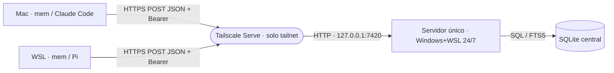

# Arquitectura mínima — BORRADOR
## Estructura y evidencia
Actual confirmado: un paquete TypeScript/Node (`package.json`); SQLite/FTS5 (`src/memory.ts`); HTTP API actualmente HTTPS (`src/http-server.ts`).
Objetivo confirmado por Franco: conservar un repo y SQLite/FTS5; lo siguiente es contrato objetivo pendiente, no implementación validada.
## Diagrama objetivo

## Componentes y configuración objetivo
Servidor: `mem serve --port <puerto>`, predeterminado 7420, escucha exclusivamente 127.0.0.1; no abre TLS propio.
DB: MEM_DB prevalece sobre ~/.mem/mem.sqlite; solo el servidor la abre. Transacciones mantienen tabla y FTS5 persistente coherentes.
Token servidor: MEM_TOKEN prevalece sobre ~/.mem/token; secreto nunca impreso ni incluido en errores/logs; falta de token impide arrancar.
Clientes Mac/WSL: MEM_URL y MEM_TOKEN; nunca abren DB local ni recurren a ella si falla la red.
Scope cliente predeterminado: project:<nombre de carpeta raíz git>; fuera de Git exige scope explícito, sin inventar proyecto.
## Contrato HTTP objetivo (decisión de este borrador)
Todos los endpoints son POST, Content-Type: application/json y Authorization: Bearer <token>; respuestas JSON UTF-8 con salto de línea final.
Objeto Memory exacto: {"id":"...","type":"decision","scope":"project:Don Financio","text":"...","origin":"claude-code/mac","date":"2026-11-05"}.
Todos sus campos son cadenas; id/text/origin no vacíos; date fecha civil válida YYYY-MM-DD; type en decision/learning/resolved-blocker/rule.
Scope válido: general o project:<nombre no vacío sin espacios externos>; no hay lista Atlas/Birch ni prohibición especial para rule general.
Save: POST /v1/memories con {"memory":Memory}; 200 devuelve Memory, conservando envoltorio de entrada y respuesta actuales.
Mismo ID y contenido idéntico: 200 sin duplicar; mismo ID con contenido diferente: 409 {"error":"id_conflict"}; nunca sobrescribe.
Search: POST /v1/search con {"scope":"project:Don Financio","query":"decisión crédito"}; 200 {"memories":[Memory]}.
Recent: POST /v1/recent con {"scope":"project:Don Financio","limit":15}; limit opcional, entero positivo, predeterminado 15; cliente --limit lo transmite; 200 {"memories":[Memory]}, máximo limit, date DESC y desempate id ASC.
Forget: POST /v1/forget con {"id":"..."}; 200 {"ok":true}, incluso si no existe; borra memoria y entrada FTS en la misma transacción.
Forget es explícito, no efecto automático de una búsqueda; tras olvidar, el ID puede guardarse otra vez.
Search/recent consideran scope exacto más general, sin otros proyectos; general solo incluye general.
Search tokeniza letras/números como literales, une con OR y ordena bm25(memories_fts) ASC, id ASC; consulta vacía/sin términos devuelve lista vacía.
FTS5 persistente con filtro de scope SQL; nunca crear una tabla FTS5 temporal para buscar.
Solo search devuelve como máximo 5 elementos y 4000 bytes UTF-8 contando JSON y salto final; omitir candidatos completos que no quepan, sin truncar campos. Recent no aplica esos topes (corrección de Franco).
Éxito sin datos: 200 {"memories":[]}; Memory de salida tiene solo los seis campos, no metadatos internos heredados.
Errores: 401 unauthorized (antes de procesar petición); 404 not_found (ruta); 405 method_not_allowed; 400 invalid_request (JSON, campos o valores inválidos).
Error interno: 500 {"error":"internal_error"}; cada error usa {"error":"código"}, sin secretos, SQL ni trazas.
No aceptar campos adicionales; sin cookies ni token en URL; un único encabezado Authorization. Endpoints replacements/conflicts quedan fuera del contrato objetivo.
## Integración y operación objetivo
Cliente sin servidor: stderr de una línea `mem: servidor no disponible`, salida no cero; sin stack ni token.
Claude SessionStart consulta recent para scope Git e inyecta memorias; sin datos o servidor, termina silenciosamente sin bloquear sesión.
Pi requiere integración explícita de inicio equivalente para inyectar recent al abrir dentro del repo; necesaria para MVP, sin MCP.
S4 entrega scripts systemd en WSL y Tailscale Serve hacia loopback; solo Franco instala/configura persistencia de WSL en Windows 24/7.
Backup S4: tarea nocturna sqlite3 .backup sobre DB central, comprobar éxito antes de retener las siete últimas copias exitosas; no copiar archivo abierto directamente.
Los scripts no se ejecutan aquí; restauración/saneamiento/runbooks y backups sintéticos se retiran, no se confunden con este backup real.
## Decisiones y alternativas
Centralizar evita divergencias; se descarta DB por cliente/sincronización. Cambiaría solo si Franco exige uso offline.
Tailscale Serve evita gestionar CA/TLS; se descarta HTTPS propio. Cambiaría si se requiere acceso fuera del tailnet.
SQLite/FTS5 OR+BM25 satisface alcance simple; se descartan servicio DB y embeddings. Cambiaría con evidencia de límites reales.
Conservar rutas save/search reduce ruptura; añadir recent/forget cubre inicio y olvido. Se descarta ampliar replacements/conflicts por no ser necesario al MVP.
## Estado actual frente al objetivo
Leído en src/http-server.ts: hoy existen /v1/memories, /v1/search, /v1/replacements y /v1/conflicts, no recent/forget; errores de store se convierten en 403 forbidden.
Leído en src/memory.ts y src/response.ts: hoy búsqueda AND con FTS temporal y metadatos internos; límite 5/4000 ya existe. Cambios anteriores requieren pruebas S1–S5.
No se verificó funcionamiento operativo ni despliegue; riesgo residual: continuidad Windows/WSL, red tailnet e integración real de ambos agentes requieren evidencia de Franco.
