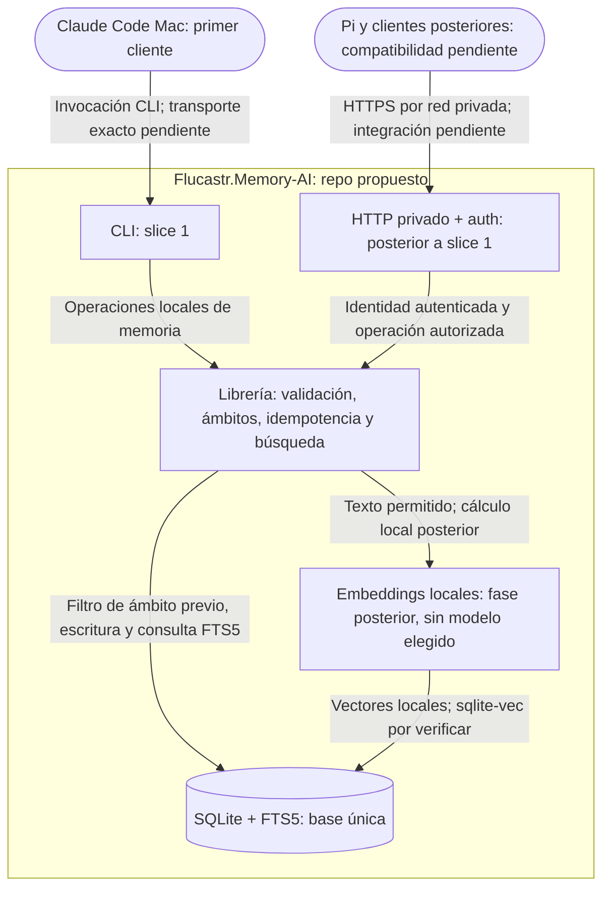

# Arquitectura propuesta — modo nueva

## Estructura y su razón
**Documento aprobado por Franco junto con los documentos de puerta 1; las propuestas no resueltas conservan su carácter de propuesta.** Enmienda explícitamente aprobada antes de F02 incorporada solo en los puntos afectados. Entradas: requisitos explícitos de Franco recogidos en PROJECT.md y su enmienda. Se propone un único repo Flucastr.Memory-AI con librería independiente y adaptadores CLI/HTTP: simplicidad y reutilización. Varios repos no aportan hoy independencia demostrada; reconsiderar si aparecen equipos o ciclos separados. No se presupone estructura de carpetas ni dependencias.

## Diagrama
Vista conceptual objetivo; HTTP y clientes posteriores **no forman parte de slice 1**. El contenedor representa el único repo propuesto, no un servidor público. Ubicación final de la central pendiente.

## Componentes
| Componente | Responsabilidad | Tecnología | Origen del dato |
|---|---|---|---|
| Librería | Validar contenido/metadatos, idempotencia, ámbitos previos y límites de salida | TypeScript/Node confirmado; interfaces pendientes | Encargo de Franco |
| CLI | Guardar/buscar para primer cliente Mac | TypeScript/Node confirmado; comandos aún no definidos | Encargo de Franco |
| Base única | Persistencia y búsqueda léxica | SQLite+FTS5 confirmado conceptualmente; binding/build no verificado | Encargo de Franco |
| HTTP privado | Acceso multidispositivo autenticado | Requisito confirmado; framework/auth/transporte por elegir | Encargo de Franco |
| Embeddings | Búsqueda semántica posterior con fallback FTS5 | Local, pequeño; sqlite-vec+RRF indicados como orientación posterior, compatibilidad pendiente | Encargo de Franco |
| Clientes | Consumir núcleo por adaptadores, sin réplicas iniciales | Claude Code CLI primero, Pi después, móviles posteriores; MCP no prometido | Encargo de Franco |

## Decisiones
| Decisión | Por qué | Descartado y por qué | Qué la cambiaría |
|---|---|---|---|
| Propuesta: único repo | Núcleo y adaptadores comparten contrato | Repos por dispositivo: complejidad sin evidencia | Ciclos/equipos independientes |
| Confirmada: filtro antes de búsqueda | Evitar filtración entre proyectos | Filtrar solo resultados: no satisface requisito | No cambia sin aprobación explícita |
| Propuesta: autorización de ámbito dentro del núcleo para ambos adaptadores | No confiar solo en filtro enviado por cliente | HTTP como único guardián: CLI podría divergir | Definición técnica de autorización HTTP |
| Confirmada — enmienda de Franco: proyecto incluye ese proyecto + general; general solo general; nunca cruzar proyectos | Memoria general reutilizable con aislamiento | Cruce de proyectos o exclusión de general en consulta de proyecto: incumplen contrato | Cambio explícito de ámbitos |
| Confirmada — enmienda de Franco: CLI slice 1 usa identidad local confiable y exige confirmación explícita al guardar reglas generales | Acceso local sin adelantar autenticación API | Auth HTTP en slice 1: fuera de alcance; general sin confirmación: no autorizado | Auth API en su slice correspondiente |
| Confirmada — enmienda de Franco: ID estable del emisor, reintento idéntico sin duplicación, mismo ID y contenido distinto rechazado | Idempotencia sin confundir cambios con reintentos | Deduplicación automática por texto o sobrescritura del mismo ID: no cumplen identidad del contenido | Cambio explícito del contrato |
| Confirmada — enmienda de Franco: sustitución con nuevo ID y referencia anterior; conflictos señalados hasta resolución humana de Franco | Preservar antecedentes y no decidir verdad automáticamente | Resolución automática por fecha: no prueba verdad | Nueva política aprobada |
| Confirmada — enmienda de Franco: sin caducidad/purga automática; archivados excluidos de búsqueda normal | Evitar pérdida automática y resultados obsoletos archivados | Caducidad por tipo: riesgo de pérdida no aceptado en este contrato | Nueva política aprobada |
| Confirmada: HTTP privado autenticado antes de embeddings | Multidispositivo tiene prioridad | Exposición pública o inferencia primero: fuera de restricciones | Cambio explícito de alcance |
| Propuesta: alojamiento diferido | Falta equipo, presupuesto y disponibilidad | Elegir VPS o equipo ahora: supuesto injustificado | Revisión de comparación en PROJECT.md |

### Política F03: HTTP local sintético
**Confirmado — origen: aprobación explícita de Franco comunicada en el encargo de esta actualización.** Esta política acota F03, no acredita implementación ni integración de clientes. La incorporación documental queda como borrador para revisión de fidelidad; no reabre lo ya aprobado.

| Decisión | Por qué | Descartado y por qué | Qué la cambiaría |
|---|---|---|---|
| HTTP local únicamente con datos sintéticos y proyectos ficticios Atlas/Birch | El entorno actual no acredita separación frente al agente y su shell | Datos reales o prometer aislamiento del shell: no hay evidencia que lo sostenga | Separación acreditada y autorización explícita de Franco |
| Key compartida representa una única identidad | Refleja la identidad aprobada sin atribuciones ficticias | Identificar cliente o humanidad por esa key: no es demostrable; revocación individual por cliente: no corresponde a una identidad compartida | Nueva política de identidades aprobada |
| Allowlist cerrada Atlas/Birch y autorización fail-closed, incluida toda referencia a registros | Evitar acceso cruzado por ámbito, ID o relaciones | Confiar en el ámbito declarado o validar solo el nuevo registro: permite referencias fuera de permiso | Cambio explícito de permisos |
| Administración humana manual separada, sin tickets, y acciones protegidas cerradas por HTTP | La posesión de la key no prueba intervención humana | Booleanos administrativos o confirmaciones HTTP: no establecen una frontera humana; tickets: no aprobados | Nueva política explícita y separación acreditada |

**Operaciones de agentes autorizadas por HTTP:** buscar; guardar recuerdos ordinarios de los cuatro tipos en `project:Atlas` y `project:Birch`, y de los tres tipos distintos de `rule` en `general`; marcar conflictos; sustituir únicamente dentro del mismo proyecto autorizado. Se mantienen identidad, idempotencia y contratos de F02. Buscar en un proyecto autorizado compone ese proyecto más `general`; buscar en `general` devuelve solo general. Esa composición no concede acceso a ningún otro proyecto. La allowlist restringe la autorización de esta identidad HTTP, no modifica la sintaxis abierta de nombres del contrato F02.

**Comprobación de referencias:** antes de consultar o mutar mediante IDs o relaciones, comprobar permisos sobre los registros referenciados además del ámbito solicitado y del registro nuevo. Incluye registros anteriores de sustitución y participantes de conflicto; una sustitución exige que ambos pertenezcan al mismo proyecto autorizado. Si no puede acreditarse el permiso, rechazar sin mutación ni revelar contenido fuera de permiso. No basta que el cliente declare Atlas/Birch.

### Rotación, durabilidad y recuperación F03
**Confirmado — origen: Franco respondió «si, apruebo todo» a las propuestas explícitas reproducidas en el encargo de esta actualización.** Se aprueban las políticas siguientes, no una implementación ni resultados de pruebas. Esta incorporación documental es **borrador de fidelidad**; no reabre las decisiones aprobadas.

| Decisión | Por qué | Descartado y por qué | Qué la cambiaría |
|---|---|---|---|
| Rotar la key compartida cada 30 días, con gracia máxima de 24 h para actualizar clientes | Acotar vigencia y permitir la transición aprobada | Vigencia indefinida o gracia mayor: fuera de la política aprobada | Nueva aprobación explícita de Franco |
| Ante filtración, revocación inmediata sin gracia; afecta a toda la identidad compartida | Cortar el acceso comprometido sin atribuir identidades individuales ficticias | Mantener la key filtrada durante la gracia: contradice la revocación inmediata | Nueva política de identidades y seguridad aprobada |
| Copias diarias; RPO máximo de 24 h ante pérdida de disco; RTO objetivo de 4 h; retención de 7 diarias y 4 semanales | Fijar los objetivos de recuperación y conservación aprobados | RPO cero ante pérdida de disco, RTO garantizado o retención indefinida: no aprobados ni demostrados | Nuevos objetivos aprobados o evidencia que exija revisar su viabilidad |
| Pruebas locales exclusivamente con claves y datos sintéticos efímeros y destino temporal | Permitir validar el diseño local sin usar información confiable ni inventar infraestructura | Copias reales o considerar el temporal independiente del disco: no hay destino real definido ni independencia acreditada | Destino real independiente, cifrado, custodia y separación administrativa concretados y autorizados |
| Para uso real, copias cifradas en destino independiente y custodia de cifrado detallada antes de habilitarlo | La recuperación de un disco perdido requiere una copia accesible fuera de ese fallo y claves recuperables | Inventar ruta, proveedor o custodio a partir de «apruebo todo»: la aprobación no proporciona esos datos | Definición y aprobación explícitas de esos detalles |

**Administración:** rotación y revocación se administran solo desde un contexto confiable separado; no se agregan endpoints de agentes para gestionar claves. Se conservan sin tickets, la pausa de escrituras y todas las acciones protegidas cerradas por HTTP de §Seguridad. En el entorno local sin separación acreditada solo pueden ensayarse estos comportamientos con material sintético efímero, sin afirmar una frontera segura frente al shell del agente.

**Durabilidad y evidencia:** el objetivo ante caída/reinicio del proceso es no perder escrituras confirmadas, sujeto a pruebas; no equivale a RPO cero ante pérdida de disco. Las pruebas locales deben verificar rotación ordinaria y fin de gracia, revocación inmediata por filtración, restauración y conservación de escrituras confirmadas ante caída del proceso, sin presentar estos resultados como ya obtenidos. Restaurar desde un destino temporal permite probar el procedimiento, pero no acredita independencia física, protección ante pérdida de disco ni un RTO real medido de 4 h. El objetivo RPO de 24 h corresponde al escenario de copias reales independientes; no es una garantía del entorno sintético.

**Alcance para planificación — inferido de la política aprobada:** la definición permite descomponer F03 **LOCAL sintética**, manteniendo allowlist Atlas/Birch, identidad compartida y permisos previos, sin elegir hosting, integrar clientes reales ni habilitar uso remoto/real. Los mecanismos técnicos de autenticación, revocación, copia consistente y restauración deben concretarse y probarse durante ese diseño local; esta conclusión no modifica BACKLOG.md ni STATUS.md ni declara la entrega implementada.

### Contrato mínimo de entrada F02
**Confirmado — origen: aprobación explícita de Franco del contrato mínimo F02 comunicada en el encargo de esta incorporación.**

- El recuerdo es un objeto cerrado con exactamente seis campos obligatorios de tipo string, nunca null: `id`, `type`, `scope`, `text`, `origin`, `date`. Se rechazan campos extra y entradas inválidas antes de escribir; no se imponen límites arbitrarios de longitud.
- `id`, `text` y `origin` deben contener algún carácter no blanco. Sus valores se conservan literalmente, sin recorte ni normalización.
- `type` admite únicamente `decision`, `learning`, `resolved-blocker` o `rule`.
- `scope` es exactamente `general` o `project:<nombre>`; el nombre debe ser no vacío, sin blancos extremos y sensible a mayúsculas. No se enumera ni restringe el conjunto de proyectos.
- `date` es la fecha civil del hecho atribuida y aportada obligatoriamente por el emisor, no la fecha de guardado, y no tiene valor por defecto. Su formato exacto es `YYYY-MM-DD`, con años `0001`–`9999` y fecha válida del calendario gregoriano, sin horas, zonas ni conversiones. No se incorporan timestamps internos.
- El mismo `id` y los mismos seis valores literales identifican el mismo recuerdo: el reintento no inserta; el orden de propiedades es irrelevante. Cualquier diferencia con el mismo `id` se rechaza sin mutación. IDs distintos con igual texto se conservan.
- La confirmación de una `rule` de ámbito `general` es la opción de operación `confirmGeneralRule`, no un campo del recuerdo. Los contratos existentes de ciclo de vida se mantienen sin ampliación.

**Decisión y justificación:** fijar este contrato mínimo permite validar la entrada e identidad sin inventar un esquema durante la construcción. Se descartan campos adicionales, normalización, fechas de guardado/defaults y deduplicación por texto porque alterarían el contrato aprobado. Cambiarlo requiere nueva aprobación explícita de Franco; no decide el esquema físico ni el algoritmo técnico.

## Seguridad
**Confirmado — origen: aprobación explícita de Franco en el encargo F03.** Crear reglas generales, sustituir recuerdos generales, archivar en cualquier ámbito, resolver conflictos y administrar claves, restauraciones o saneamiento están **cerrados por HTTP**. No se habilitan mediante `confirmGeneralRule`, otros booleanos administrativos, una key compartida ni una declaración de humanidad. La confirmación local de F02 no es autorización administrativa HTTP.

La administración humana es manual y separada, sin tickets; requiere cuenta, instalación y datos fuera del alcance del agente y de su shell, con pausa de escrituras durante revisión y ejecución. El entorno actual **no acredita esa separación**: F03 queda limitado a datos sintéticos y no habilita administración protegida sobre datos confiables. No se promete aislamiento del shell ni se presenta la CLI actual como canal humano seguro. Señalar conflictos no equivale a resolverlos.

## Supuestos y pendientes
- El esquema mínimo de entrada F02 queda aprobado en §Decisiones, «Contrato mínimo de entrada F02». Siguen pendientes dependencias, versiones, algoritmo técnico exacto de idempotencia y esquema físico de persistencia. El contrato funcional de ID estable del emisor, reintentos, rechazo y sustitución queda aprobado arriba; no hay deduplicación automática por texto.
- **Confirmado — origen: encargo F03:** composición F02 e identidad local de CLI conservadas; para HTTP local sintético quedan aprobadas identidad única con key compartida, allowlist Atlas/Birch y operaciones acotadas en §Decisiones y §Seguridad. La key no atribuye cliente ni humanidad y su revocación afecta a la identidad compartida; no se afirma que el mecanismo esté implementado. La VPN no autoriza por sí sola operaciones o proyectos.
- **Confirmado — origen: aprobación «si, apruebo todo» comunicada en el encargo:** rotación cada 30 días, gracia máxima de 24 h y revocación inmediata sin gracia ante filtración; copias diarias, RPO máximo 24 h ante pérdida de disco, RTO objetivo 4 h y retención 7 diarias + 4 semanales, según §Decisiones, «Rotación, durabilidad y recuperación F03». Los mecanismos concretos quedan por diseñar y verificar localmente, no las políticas ya aprobadas.
- **Pendiente para uso real/remoto — origen: datos no proporcionados en el encargo:** nombre/ruta y características del destino real independiente; mecanismo de cifrado y custodia/recuperación de sus claves. La aprobación no identifica infraestructura ni custodio. Deben detallarse antes de usar copias reales; no bloquean la descomposición LOCAL sintética con destino temporal. Backup/restauración y saneamiento siguen cerrados administrativamente por HTTP.
- **Pendiente — origen: encargo F03:** acreditar cuenta, instalación y datos administrativos fuera del alcance del agente/shell y el procedimiento de pausa de escrituras antes de usar datos confiables. HTTPS remoto privado queda pendiente de mecanismo y despliegue, sin elegir infraestructura ni prometer clientes integrados. Esta actualización no altera backlog, dependencias ni estados.
- No registrar secretos ni cuerpos completos por defecto: propuesta para revisión, no decisión nueva.
- Embeddings requieren modelo/licencia, memoria medida con trabajo concurrente, soporte runtime/OS y disponibilidad de sqlite-vec verificados. No se asume GPU compartida entre Mac y WSL.
- **Contrato de gate confirmado — enmienda de Franco:** 30 recuerdos sintéticos verosímiles MVP de decisiones, aprendizajes, bloqueos resueltos y reglas; ámbito general y al menos dos proyectos ficticios; 10 consultas con esperados top 5 prefijados. Corpus versionado, separado de lógica y reemplazable por datos reales. Reemplaza la exigencia inicial de datos reales; baseline = archivo de concatenación del mismo corpus completo. No generar corpus ni código en esta enmienda; aún no existen estos artefactos y no se afirma que el gate pasó.
- **Contrato de salida confirmado — enmienda de Franco:** máximo cinco recuerdos y 4000 bytes de respuesta serializada UTF-8 completa, incluido salto final. Omitir recuerdos enteros que no caben, nunca truncarlos. Comparar con baseline sin umbral porcentual adicional. El informe de reducción de contexto es solo resultado de prueba, no uso real ni ahorro real. Se descartan baseline de datos distintos y conteo parcial porque no permiten validar este contrato; cambiarlo requiere decisión explícita.
- Orden completo posterior no aprobado; solo slice 1 conceptual y restricciones de precedencia confirmadas.

## Estado
**Aprobado — aprobación documental previa de Franco conservada.** Las propuestas y pendientes ajenos a esta enmienda no se convierten en decisiones aprobadas. No describe componentes existentes. **Confirmado — autorización explícita de Franco:** «Puedes descomponer F02 con esto»; la enmienda ya está aprobada y no exige reaprobar idénticas decisiones. La descomposición corresponde al planificador, no a esta actualización documental.
